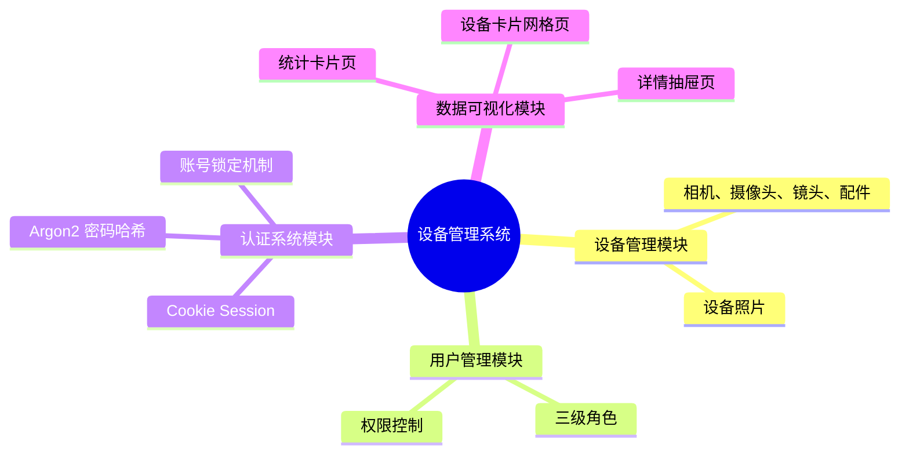

# 01-概况篇

欢迎来到设备管理系统开发教程。本篇将带你快速了解系统全貌，为后续的开发打下基础。

## 1. 项目简介

设备管理系统主要用于管理相机、摄像机、镜头和配件等摄影器材。系统提供完整的增删改查功能、用户权限管理、认证系统以及数据可视化仪表盘。

**核心功能模块：**



## 2. 技术栈

### 2.1 前端

| 名称 | 版本号 | 作用 |
|------|--------|------|
| Vue | 3.5.13 | 渐进式 JavaScript 框架|
| TypeScript | 6.0.0 | 类型安全的 JavaScript 超集 |
| Vite | 8.3.5 | 前端构建工具 |
| Ant Design Vue | 4.2.6 | 企业级 UI 组件库 |
| Pinia | 4.1.0 | Vue 状态管理库 |
| Vue Router | 5.4.0 | 官方路由管理器 |
| Axios | 1.7.9 | HTTP 客户端 |
| unplugin-vue-components | 32.1.0 | 组件自动导入插件 |

### 2.2 后端

| 名称 | 版本号 | 作用 |
|------|--------|------|
| Python | 3.13+ | 后端编程语言 |
| FastAPI | - | 现代高性能的 Web 框架 |
| uvicorn | - | ASGI 服务器 |
| pwdlib[argon2] | - | 密码哈希库（Argon2 算法） |
| SQLite | - | 轻量级嵌入式数据库（Python 内置） |

### 2.3 部署

| 名称 | 版本号 | 作用 |
|------|--------|------|
| IIS | Windows 自带 | Web 服务器，托管静态文件和反向代理 |
| HttpPlatformHandler | IIS 模块 | 管理后端进程生命周期 |

## 3. 系统架构

### 3.1 整体架构

```
┌─────────────┐
│   浏览器    │
└──────┬──────┘
       │ HTTPS (443)
       ▼
┌─────────────────┐
│      IIS        │  ← 静态文件托管 + 反向代理
│  (wwwroot/)     │
└──────┬──────────┘
       │ HTTP (通过 HttpPlatformHandler)
       ▼
┌─────────────────┐
│    uvicorn      │  ← FastAPI 应用
│  (backend/)     │
└──────┬──────────┘
       │
       ▼
┌─────────────────┐
│  SQLite 数据库  │  ← db/HopeEquipment.db
│    (db/)        │
└─────────────────┘
```

**开发模式：**
- 前端：`http://localhost:5173`（Vite 开发服务器）
- 后端：`http://localhost:8000`（uvicorn）
- Vite 自动代理 `/api` 请求到后端

**生产模式：**
- IIS 托管前端静态文件（`wwwroot/`）
- HttpPlatformHandler 启动 uvicorn 进程
- IIS 反向代理 `/api` 请求到 uvicorn
- 统一通过 HTTPS 443 端口访问

### 3.2 选型理由

#### 3.2.1 Q1: 数据库端为什么使用SQLite数据库？

- **轻量级**：无需安装数据库服务器，单文件部署，备份 = 复制文件
- **零配置**：没有端口、用户、权限配置，开箱即用
- **Python 内置**：标准库 `sqlite3`，无需额外驱动
- **够用**：我们管理的设备不超过1000个，且设备信息不会频繁变更，使用人数少，可以接受。

#### 3.2.2 Q2: 后端为什么选用基于Python的FastAPI框架，以及选用uvicorn的理由？

**FastAPI：**
- **高性能**：基于 Starlette 和 Pydantic，性能接近 Node.js/Go
- **类型安全**：自动参数验证，生成 OpenAPI 文档
- **开发效率**：代码简洁，依赖注入机制强大
- **异步支持**：原生支持 async/await

**uvicorn：**
- **ASGI 服务器**：FastAPI 官方推荐，支持异步
- **生产就绪**：稳定可靠，支持热重载（开发模式）
- **简单易用**：一条命令启动，配置简单

#### 3.2.3 Q3: 前端为什么使用Vue3？

- **渐进式框架**：可以逐步采用，学习曲线平缓
- **Composition API**：逻辑复用更方便，代码组织更清晰
- **TypeScript 支持**：类型推导优秀，开发体验好
- **生态完善**：Vue Router、Pinia、Ant Design Vue 等配套成熟
- **中文友好**：文档和社区资源丰富

#### 3.2.4 Q4: 部署端为什么使用IIS？

- **Windows 环境**：服务器是 Windows Server，IIS 是原生组件
- **统一管理**：图形界面管理网站、证书、日志
- **HttpPlatformHandler**：微软官方模块，专门代理到后端进程
- **进程管理**：自动启动、崩溃恢复、开机自启
- **静态文件性能**：IIS 托管静态文件性能优秀，无需额外配置

### 3.3 代码目录结构

```
HopeEquipment/
├── backend/              # 后端代码
│   ├── __init__.py      # Python 包标识
│   ├── main.py          # FastAPI 应用入口
│   ├── db.py            # 数据库操作封装
│   ├── auth.py          # 认证与权限管理
│   └── routers/         # API 路由
│       ├── __init__.py  # 通用 CRUD 路由工厂
│       └── users.py     # 用户相关路由
├── frontend/            # 前端代码
│   ├── src/
│   │   ├── main.ts      # 应用入口
│   │   ├── App.vue      # 根组件
│   │   ├── router.ts    # 路由配置
│   │   ├── api.ts       # API 请求封装
│   │   ├── equipmentPhotos.ts  # 设备照片映射
│   │   ├── env.d.ts     # TypeScript 环境声明
│   │   ├── stores/      # Pinia 状态管理
│   │   │   └── auth.ts  # 认证状态
│   │   ├── pages/       # 页面组件
│   │   │   ├── Login.vue
│   │   │   ├── Setup.vue
│   │   │   ├── Dashboard.vue
│   │   │   ├── Camera.vue
│   │   │   ├── Camcorder.vue
│   │   │   ├── Lens.vue
│   │   │   ├── Accessory.vue
│   │   │   ├── Users.vue
│   │   │   └── Forbidden.vue
│   │   ├── components/  # 通用组件
│   │   │   ├── EquipmentFormModal.vue
│   │   │   └── PasswordChangeModal.vue
│   │   ├── layouts/     # 布局组件
│   │   │   └── MainLayout.vue
│   │   └── assets/      # 静态资源
│   │       ├── favicon.ico
│   │       ├── logo.png
│   │       └── equipment/  # 设备照片（63 张）
│   ├── index.html       # HTML 入口
│   ├── package.json     # 依赖配置
│   ├── tsconfig.json    # TypeScript 配置
│   └── vite.config.ts   # Vite 配置
├── db/                  # 数据库
│   ├── HopeEquipment.db # SQLite 数据库文件（运行时生成）
│   ├── HopeEquipment.sql # 数据库 Schema
│   ├── create_database_schema.py  # 建表脚本
│   └── get_database_schema.py     # Schema 导出工具
├── deploy/              # 部署相关
│   ├── package.py       # 打包脚本
│   ├── server/          # 服务器配置
│   │   ├── run_server.py # 生产启动脚本
│   │   └── web.config   # IIS 配置
└── requirements.txt     # Python 依赖
```

## 4. 开发环境搭建

### 4.1 前置要求

- **Python 3.13+**：[下载地址](https://www.python.org/downloads/)
- **Node.js 18+**：[下载地址](https://nodejs.org/)
- **Git**：[下载地址](https://git-scm.com/)

### 4.2 后端启动

1. **安装依赖**

```bash
# 在项目根目录
pip install -r requirements.txt
```

依赖说明：
- `fastapi` — Web 框架
- `uvicorn` — ASGI 服务器
- `pwdlib[argon2]` — 密码哈希（Argon2 算法）

2. **启动服务**

```bash
uvicorn backend.main:app --reload --host 0.0.0.0 --port 8000
```

- `--reload`：开发模式，代码修改自动重启
- `--host 0.0.0.0`：监听所有网络接口
- `--port 8000`：端口 8000

3. **验证**

访问 `http://localhost:8000/docs` 查看自动生成的 API 文档（Swagger UI）。

### 4.3 前端启动

1. **安装依赖**

```bash
cd frontend
npm install
```

2. **启动开发服务器**

```bash
npm run dev
```

3. **验证**

访问 `http://localhost:5173`，应该能看到登录页面。

### 4.4 Vite 代理配置

开发时，前端和后端运行在不同端口。Vite 会自动将 `/api` 请求代理到后端：

```typescript
// frontend/vite.config.ts (L25-L31)
  server: {
    port: 5173,
    proxy: {
      '/api': {
        target: 'http://localhost:8000',
        changeOrigin: true,
      },
    },
  },
```

这样前端代码中的 `http.get('/api/users')` 会被代理到 `http://localhost:8000/api/users`。

## 5. 功能模块一览

### 5.1 设备管理

**四类设备：**
- **相机（camera）**：序列号、品牌、型号、卡口、存放地点等
- **摄像机（camcorder）**：字段与相机类似
- **镜头（lens）**：除基本信息外，关联到相机/摄像机（`ref_id`）
- **配件（accessory）**：关联到相机/摄像机，按类型分组（`acc_type`）

**设备状态：**
- 正常（绿色）
- 维修（橙色）
- 退役（红色）

**功能：**
- 设备列表（表格展示，支持分页、排序）
- 新增、编辑、删除设备
- 设备照片上传与展示
- 设备详情查看（关联镜头、配件）

### 5.2 仪表盘

**统计卡片：**
- 展示四类设备的数量统计
- 按状态分类：正常 + 维修 + 退役 = 总计
- 点击卡片跳转到对应设备管理页面

**设备卡片网格：**
- 按设备类型分组展示
- 每张卡片显示设备照片、品牌、型号、状态、卡口、地点
- 点击卡片打开详情抽屉，查看关联镜头和配件

### 5.3 用户管理

**三级角色：**
- **用户（user）**：只能查看和管理设备
- **管理员（admin）**：可以管理用户（但不能管理同级或更高级别）
- **超级管理员（super_admin）**：拥有所有权限

**功能：**
- 用户列表、新增、编辑、删除
- 启用/禁用用户
- 修改密码
- 角色分配

### 5.4 认证系统

**首次初始化：**
- 访问系统时检查是否已初始化管理员
- 未初始化则跳转到 Setup 页面，创建超级管理员

**登录流程：**
- 用户名 + 密码登录
- 密码使用 Argon2 算法哈希存储
- 登录成功生成 Session Token，存储在 Cookie 中
- Session 有效期 30 分钟，自动续期

**账号安全：**
- 连续 5 次登录失败，账号锁定 15 分钟
- 支持禁用/启用账号

## 6. Vibe Coding 开发方式

本教程采用 **Vibe Coding** 的方式开发——通过与 AI 对话来生成代码。

### 什么是 Vibe Coding

**Vibe Coding** 是一种通过与 AI 对话来生成代码的编程方式：

- **你负责**：描述需求、提供上下文、验证结果
- **AI 负责**：生成代码、解释原理、修复 bug

**核心理念**：你不需要记住每个 API 的细节，只需要清楚地知道"我要什么"。

### 适用场景

- 快速原型开发
- 学习新技术栈
- 重复性工作（如 CRUD、数据库表结构）
- 不确定实现细节时快速探索

### 本项目使用的工具

本项目使用 **Qoder** 作为 AI 编程助手。Qoder 是一个 AI-first 的开发环境，支持：

- 长上下文理解，可以记住整个项目的代码
- 直接读写文件、运行命令
- 多轮对话，逐步完善代码
- 代码审查和重构建议

### 对话策略

1. **分步骤提问**：不要一次性要求所有代码，分模块逐步生成
2. **提供上下文**：告诉 AI 你的技术栈、约束条件、已有代码
3. **明确输出格式**：要求注释、示例、测试代码
4. **验证和迭代**：运行代码，发现问题，反馈给 AI 修复

本教程的每个模块都分为两部分：

| 文档类型 | 说明 | 示例 |
|----------|------|------|
| **Detail** | 详细的设计原理和代码讲解 | `02-database-detail.md` |
| **Coding** | Vibe Coding 实战对话演示 | `02-database-coding.md` |

**文档结构**：

```
doc/
├── 01-overview.md              # 概况篇
├── 02-database-detail.md       # 数据库篇 - 详细设计
├── 02-database-coding.md       # 数据库篇 - Vibe Coding 实战
├── 03-backend-detail.md        # 后端篇 - 详细实现
├── 03-backend-coding.md        # 后端篇 - Vibe Coding 实战
├── 04-frontend-detail.md       # 前端篇 - 详细实现
├── 04-frontend-coding.md       # 前端篇 - Vibe Coding 实战
└── 05-deploy.md                # 部署篇 - 服务器部署指南
```

建议阅读顺序：先读 Detail 了解设计原理，再读 Coding 学习如何用 AI 实现。

## 7. 下一步

建议按以下顺序阅读：

**数据库篇**：

1. [数据库篇（详细设计）](./02-database-detail.md) — 表结构设计、字段定义、表关系
2. [数据库篇（Vibe Coding 实战）](./02-database-coding.md) — 用 AI 从零搭建数据库

**后端篇**：

3. [后端篇（详细实现）](./03-backend-detail.md) — FastAPI 后端实现
4. [后端篇（Vibe Coding 实战）](./03-backend-coding.md) — 用 AI 从零搭建后端

**前端篇**：

5. [前端篇（详细实现）](./04-frontend-detail.md) — Vue 3 前端开发
6. [前端篇（Vibe Coding 实战）](./04-frontend-coding.md) — 用 AI 从零搭建前端

**部署篇**：

7. [部署篇](./05-deploy.md) — 将系统部署到 Windows Server
