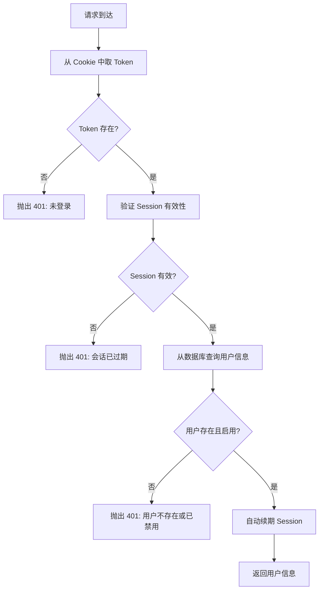
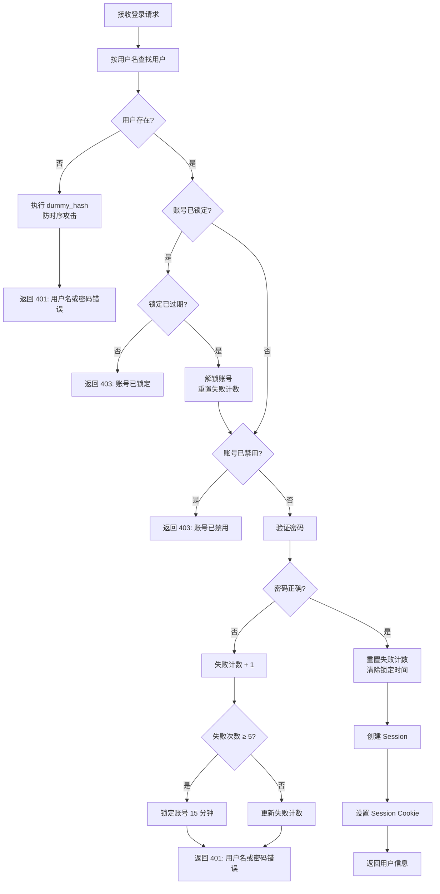

# 03-后端篇

本篇从零搭建 HopeEquipment 的 FastAPI 后端。我们将按模块逐步构建：数据库层 → 认证系统 → 路由 → 应用入口。

## 1. 项目初始化

### 1.1 目录结构

```
backend/
├── __init__.py           # 空文件，标记为 Python 包
├── main.py               # FastAPI 应用入口
├── db.py                 # 数据库操作封装
├── auth.py               # 认证与权限管理
└── routers/
    ├── __init__.py        # 通用 CRUD 路由工厂
    └── users.py           # 认证 + 用户管理路由
```

### 1.2 依赖

```txt
# requirements.txt (L1-L3)
fastapi
uvicorn
pwdlib[argon2]
```

只有 3 个依赖，非常精简：
- **fastapi** — Web 框架，提供路由、依赖注入、自动文档
- **uvicorn** — ASGI 服务器，运行 FastAPI 应用
- **pwdlib[argon2]** — 密码哈希库，Argon2 是目前最安全的密码哈希算法之一

> 如果 `pwdlib[argon2]` 安装失败（需要 C 编译器），可以改用 `pwdlib[bcrypt]`，代码中需要相应调整。

## 2. 数据库层 — db.py

`db.py` 是整个后端的基石，封装了所有 SQLite 操作。

### 2.1 完整代码

```python
# backend/db.py (L1-L54)
import sqlite3
from pathlib import Path

DB_PATH = Path(__file__).resolve().parent.parent / 'db' / 'HopeEquipment.db'


def get_connection():
    conn = sqlite3.connect(DB_PATH)
    conn.row_factory = sqlite3.Row
    return conn


def fetch_all(table: str) -> list[dict]:
    with get_connection() as conn:
        rows = conn.execute(f'SELECT * FROM {table}').fetchall()
    return [dict(r) for r in rows]


def fetch_one(table: str, id: str) -> dict | None:
    with get_connection() as conn:
        row = conn.execute(f'SELECT * FROM {table} WHERE id = ?', (id,)).fetchone()
    return dict(row) if row else None


def fetch_one_by(table: str, column: str, value: str) -> dict | None:
    with get_connection() as conn:
        row = conn.execute(f'SELECT * FROM {table} WHERE {column} = ?', (value,)).fetchone()
    return dict(row) if row else None


def insert(table: str, data: dict):
    columns = ', '.join(data.keys())
    placeholders = ', '.join(['?'] * len(data))
    with get_connection() as conn:
        conn.execute(f'INSERT INTO {table} ({columns}) VALUES ({placeholders})', list(data.values()))


def update(table: str, id: str, data: dict):
    set_clause = ', '.join([f'{k} = ?' for k in data.keys()])
    with get_connection() as conn:
        conn.execute(f'UPDATE {table} SET {set_clause} WHERE id = ?', [*data.values(), id])


def delete(table: str, id: str):
    with get_connection() as conn:
        conn.execute(f'DELETE FROM {table} WHERE id = ?', (id,))


def next_id(table: str) -> str:
    with get_connection() as conn:
        row = conn.execute(f'SELECT MAX(CAST(REPLACE(id, ?, "") AS INTEGER)) AS max_num FROM {table}',
                           (table,)).fetchone()
    num = (row['max_num'] or 0) + 1
    return f'{table}{num}'
```

上面的 8 个函数各做一件事，逐个说明：

| 函数 | 行号 | 参数 | 返回 | 示例 |
|------|------|------|------|------|
| `get_connection` | `L7-L10` | 无 | `sqlite3.Connection` | 内部函数，其余函数都用它 |
| `fetch_all` | `L13-L16` | `table` 表名 | `list[dict]` | `fetch_all('camera')` → 全部相机记录 |
| `fetch_one` | `L19-L22` | `table`、`id` 主键 | `dict \| None` | `fetch_one('camera', 'camera1')` |
| `fetch_one_by` | `L25-L28` | `table`、`column` 列名、`value` 列值 | `dict \| None` | `fetch_one_by('users', 'name', 'admin')` |
| `insert` | `L31-L35` | `table`、`data` 列名字典 | 无 | `insert('camera', {'id': 'camera1', 'brand': 'Sony'})` |
| `update` | `L38-L41` | `table`、`id`、`data` 新值字典 | 无 | `update('camera', 'camera1', {'brand': 'Canon'})` 只改 brand |
| `delete` | `L44-L46` | `table`、`id` | 无 | `delete('camera', 'camera1')` |
| `next_id` | `L49-L54` | `table` | 新 ID 字符串 | 已有 camera1~camera3 → `'camera4'`；空表 → `'camera1'` |

三个容易看漏的点：

- **`conn.row_factory = sqlite3.Row`（`L9`）**：这是整个模块能写成 `dict(r)` 的前提。默认情况下 `sqlite3` 返回元组，只能按下标取值；设成 `sqlite3.Row` 后既能 `row['brand']` 也能 `dict(row)`，返回值才是前端可直接 JSON 化的字典。
- **`with get_connection() as conn`**：`Connection` 作为上下文管理器只管事务——块内正常结束自动 `commit`，抛异常则 `rollback`；它**不会关闭连接**。对 SQLite 这种本地文件库，连接开销很小，每次操作新建一条连接反而避免了跨请求共享状态的并发问题。
- **`next_id` 的 SQL（`L51-L52`）**：`REPLACE(id, 'camera', '')` 把 `camera12` 变成 `12`，`CAST(... AS INTEGER)` 再转成数字取 `MAX`，于是 `camera2` 排在 `camera10` 前面（字符串比较会得出相反结果）。表名做前缀替换时把 `table` 作为绑定参数传入（`(table,)` 那个 `?`），而不是拼进 SQL。空表时 `MAX` 返回 `NULL`，靠 `or 0` 兜底成 1。

### 2.2 设计要点

- **通用封装**：所有函数都接收表名作为参数，不绑定具体业务表，4 张设备表共用同一套代码
- **参数化查询**：所有值都走 `?` 占位符（`fetch_one`/`fetch_one_by`/`insert`/`update`/`delete`/`next_id` 无例外），只有表名和列名是字符串拼接——因为它们不可能用占位符传入，调用方是路由代码而非用户输入

## 3. FastAPI 入口 — main.py

`main.py` 是应用的起点，负责创建 FastAPI 实例、配置中间件、注册路由。

### 3.1 完整代码

```python
# backend/main.py (L1-L55)
from pathlib import Path

from fastapi import Depends, FastAPI
from fastapi.middleware.cors import CORSMiddleware
from fastapi.responses import FileResponse
from fastapi.staticfiles import StaticFiles

from backend import db
from backend.auth import get_current_user
from backend.routers import create_router
from backend.routers.users import auth_router, users_router

app = FastAPI(title='HopeEquipment')

app.add_middleware(
    CORSMiddleware,
    allow_origins=['http://localhost:5173'],
    allow_methods=['*'],
    allow_headers=['*'],
    allow_credentials=True,
)

with db.get_connection() as conn:
    conn.execute('''
        CREATE TABLE IF NOT EXISTS users (
            id                   TEXT PRIMARY KEY,
            name                 TEXT NOT NULL UNIQUE,
            student_id           TEXT,
            grade                TEXT,
            college              TEXT,
            password_hash        TEXT NOT NULL,
            role                 TEXT NOT NULL DEFAULT 'user',
            is_active            INTEGER NOT NULL DEFAULT 1,
            access_failed_count  INTEGER NOT NULL DEFAULT 0,
            lockout_until        TEXT
        )
    ''')

app.include_router(auth_router)
app.include_router(users_router)

for table in ('camera', 'camcorder', 'lens', 'accessory'):
    app.include_router(
        create_router(table, delete_role='admin'),
        dependencies=[Depends(get_current_user)],
    )

_wwwroot = Path(__file__).resolve().parent.parent / "wwwroot"
if (_wwwroot / "assets").is_dir():
    app.mount("/assets", StaticFiles(directory=_wwwroot / "assets"), name="assets")


@app.get("/{full_path:path}")
async def _spa_fallback(full_path: str):
    return FileResponse(_wwwroot / "index.html")
```

### 3.2 逐段讲解

**创建应用：**

```python
app = FastAPI(title='HopeEquipment')
```

`title` 会显示在自动生成的 Swagger 文档中。

**CORS 配置：**

```python
app.add_middleware(
    CORSMiddleware,
    allow_origins=['http://localhost:5173'],
    allow_methods=['*'],
    allow_headers=['*'],
    allow_credentials=True,
)
```

开发模式下，前端运行在 `localhost:5173`，后端在 `localhost:8000`，跨域需要 CORS 配置。`allow_credentials=True` 允许携带 Cookie 的跨域请求。

生产模式下，前后端同域（都由 IIS 托管），不存在跨域问题。

**启动时建表：**

```python
with db.get_connection() as conn:
    conn.execute('''
        CREATE TABLE IF NOT EXISTS users (...)
    ''')
```

应用启动时自动创建 `users` 表。`IF NOT EXISTS` 确保重复启动不会报错。设备表不在这里创建——它们应该在部署时通过 SQL 脚本预先建好。

**注册路由：**

```python
app.include_router(auth_router)      # /api/auth/*
app.include_router(users_router)     # /api/users/*

for table in ('camera', 'camcorder', 'lens', 'accessory'):
    app.include_router(
        create_router(table, delete_role='admin'),
        dependencies=[Depends(get_current_user)],
    )
```

- 认证路由和用户管理路由直接注册
- 4 个设备表通过循环注册，使用 `create_router` 工厂函数生成
- `dependencies=[Depends(get_current_user)]` 表示所有设备 API 都需要登录

**生产模式 SPA 托管：**

```python
_wwwroot = Path(__file__).resolve().parent.parent / "wwwroot"
if (_wwwroot / "assets").is_dir():
    app.mount("/assets", StaticFiles(directory=_wwwroot / "assets"), name="assets")


@app.get("/{full_path:path}")
async def _spa_fallback(full_path: str):
    return FileResponse(_wwwroot / "index.html")
```

生产环境中，前端构建产物放在 `wwwroot/` 目录。FastAPI 负责：
1. 托管 `/assets/*` 静态文件（JS、CSS、图片）
2. 所有其他请求返回 `index.html`，让 Vue Router 接管前端路由

`if (_wwwroot / "assets").is_dir()` 判断是否为生产模式——开发模式下 `wwwroot/` 不存在，这段代码不会生效。

## 4. 认证系统 — auth.py

认证系统是后端的核心模块，负责密码哈希、Session 管理、权限检查。

### 4.1 完整代码

```python
# backend/auth.py (L1-L107)
import secrets
import time

from fastapi import HTTPException, Request
from pwdlib import PasswordHash

from backend import db

pwd_context = PasswordHash.recommended()

SESSION_COOKIE_NAME = 'hope_session'
SESSION_EXPIRE_SECONDS = 1800
SESSION_EXTEND_THRESHOLD_SECONDS = 300
ROLE_LEVEL = {'user': 1, 'admin': 2, 'super_admin': 3}

_sessions: dict[str, dict] = {}


def hash_password(password: str) -> str:
    return pwd_context.hash(password)


def verify_password(plain: str, hashed: str) -> bool:
    return pwd_context.verify(plain, hashed)


def dummy_hash() -> str:
    return pwd_context.hash('dummy')


def _cleanup_expired():
    now = time.time()
    expired = [t for t, s in _sessions.items() if s['expires_at'] <= now]
    for t in expired:
        del _sessions[t]


def create_session(user_id: str) -> str:
    _cleanup_expired()
    token = secrets.token_urlsafe(32)
    _sessions[token] = {'user_id': user_id, 'expires_at': time.time() + SESSION_EXPIRE_SECONDS}
    return token


def get_session(token: str) -> dict | None:
    session = _sessions.get(token)
    if not session:
        return None
    if session['expires_at'] <= time.time():
        del _sessions[token]
        return None
    return session


def delete_session(token: str):
    _sessions.pop(token, None)


def delete_user_sessions(user_id: str):
    expired = [t for t, s in _sessions.items() if s['user_id'] == user_id]
    for t in expired:
        del _sessions[t]


def extend_session(token: str):
    session = _sessions.get(token)
    if session and session['expires_at'] - time.time() < SESSION_EXTEND_THRESHOLD_SECONDS:
        session['expires_at'] = time.time() + SESSION_EXPIRE_SECONDS


def get_current_user(request: Request) -> dict:
    token = request.cookies.get(SESSION_COOKIE_NAME)
    if not token:
        raise HTTPException(status_code=401, detail='未登录')
    session = get_session(token)
    if not session:
        raise HTTPException(status_code=401, detail='会话已过期')
    user = db.fetch_one('users', session['user_id'])
    if not user or not user['is_active']:
        raise HTTPException(status_code=401, detail='用户不存在或已禁用')
    extend_session(token)
    return user


def require_role(min_role: str):
    def checker(request: Request) -> dict:
        user = get_current_user(request)
        if ROLE_LEVEL.get(user['role'], 0) < ROLE_LEVEL.get(min_role, 0):
            raise HTTPException(status_code=403, detail='权限不足')
        return user
    return checker


def set_session_cookie(response, token: str, secure: bool = True):
    response.set_cookie(
        key=SESSION_COOKIE_NAME,
        value=token,
        httponly=True,
        samesite='lax',
        secure=secure,
        max_age=SESSION_EXPIRE_SECONDS,
        path='/',
    )


def clear_session_cookie(response):
    response.delete_cookie(key=SESSION_COOKIE_NAME, path='/')
```

### 4.2 逐段讲解

**模块导入与密码哈希：**

```python
import secrets
import time

from fastapi import HTTPException, Request
from pwdlib import PasswordHash

from backend import db

pwd_context = PasswordHash.recommended()

def hash_password(password: str) -> str:
    return pwd_context.hash(password)


def verify_password(plain: str, hashed: str) -> bool:
    return pwd_context.verify(plain, hashed)


def dummy_hash() -> str:
    return pwd_context.hash('dummy')
```

- `secrets` 生成不可预测的 Session Token，`time` 负责过期时间戳。
- `pwdlib` 而不是老的 `passlib`：passlib 依赖已停更，pwdlib 原生支持 Argon2。
- `from backend import db` 用绝对导入，配合 `run_server.py` 把项目根塞进 `sys.path`（见部署篇 4.3）。
- `PasswordHash.recommended()` 使用 Argon2 算法，这是目前 OWASP 推荐的密码哈希方案
- `hash_password` 将明文密码转为哈希值，存入数据库
- `verify_password` 验证用户输入的密码是否匹配
- `dummy_hash` 是一个安全措施：当用户名不存在时，仍然执行一次哈希计算，防止攻击者通过响应时间判断用户名是否存在（时序攻击）

**Session 管理：**

```python
SESSION_COOKIE_NAME = 'hope_session'
SESSION_EXPIRE_SECONDS = 1800
SESSION_EXTEND_THRESHOLD_SECONDS = 300
ROLE_LEVEL = {'user': 1, 'admin': 2, 'super_admin': 3}

_sessions: dict[str, dict] = {}
```

Session 存储在**内存字典**中（`_sessions`），不是数据库。Key 是 Session Token，Value 包含 `user_id` 和 `expires_at`。

- Session 有效期 30 分钟（1800 秒）
- 剩余不足 5 分钟（300 秒）时自动续期
- 服务器重启后所有 Session 失效（内存数据丢失）

> 对于小型内部系统，内存 Session 足够用。如果需要持久化 Session，可以改为存储在 SQLite 或 Redis 中。

**清理过期 Session：**

```python
def _cleanup_expired():
    now = time.time()
    expired = [t for t, s in _sessions.items() if s['expires_at'] <= now]
    for t in expired:
        del _sessions[t]
```

没有独立的定时器，过期记录是在**创建新 Session 时顺带清掉**的（见下面的 `create_session`）。字典推导式先收集所有 `expires_at <= now` 的 token，再逐个 `del`——不能在遍历 `_sessions` 的同时删除，否则会 `RuntimeError: dictionary changed size during iteration`。

**创建 Session：**

```python
def create_session(user_id: str) -> str:
    _cleanup_expired()
    token = secrets.token_urlsafe(32)
    _sessions[token] = {'user_id': user_id, 'expires_at': time.time() + SESSION_EXPIRE_SECONDS}
    return token
```

使用 `secrets.token_urlsafe(32)` 生成 32 字节的随机 Token，URL 安全。

**获取 Session：**

```python
def get_session(token: str) -> dict | None:
    session = _sessions.get(token)
    if not session:
        return None
    if session['expires_at'] <= time.time():
        del _sessions[token]
        return None
    return session
```

Token 不存在或已过期，返回 None。

**销毁 Session：**

```python
def delete_session(token: str):
    _sessions.pop(token, None)


def delete_user_sessions(user_id: str):
    expired = [t for t, s in _sessions.items() if s['user_id'] == user_id]
    for t in expired:
        del _sessions[t]
```

`pop(token, None)` 给默认值，重复登出不会抛 `KeyError`。`delete_user_sessions` 按用户批量清除，用于管理员禁用/删除账号时立刻吊销该用户的全部会话（见 5.4 的用户删除路由）。

**自动续期：**

```python
def extend_session(token: str):
    session = _sessions.get(token)
    if session and session['expires_at'] - time.time() < SESSION_EXTEND_THRESHOLD_SECONDS:
        session['expires_at'] = time.time() + SESSION_EXPIRE_SECONDS
```

每次请求时调用，如果 Session 剩余时间不足 5 分钟，重置为 30 分钟。这样活跃用户不会被踢出。

**权限检查：**

```python
def get_current_user(request: Request) -> dict:
    token = request.cookies.get(SESSION_COOKIE_NAME)
    if not token:
        raise HTTPException(status_code=401, detail='未登录')
    session = get_session(token)
    if not session:
        raise HTTPException(status_code=401, detail='会话已过期')
    user = db.fetch_one('users', session['user_id'])
    if not user or not user['is_active']:
        raise HTTPException(status_code=401, detail='用户不存在或已禁用')
    extend_session(token)
    return user
```

这是 FastAPI 的**依赖注入**函数。路由中声明 `user: dict = Depends(get_current_user)`，FastAPI 会自动调用它获取当前用户。流程：



**角色权限检查：**

```python
def require_role(min_role: str):
    def checker(request: Request) -> dict:
        user = get_current_user(request)
        if ROLE_LEVEL.get(user['role'], 0) < ROLE_LEVEL.get(min_role, 0):
            raise HTTPException(status_code=403, detail='权限不足')
        return user
    return checker
```

这是一个**依赖工厂**——返回一个依赖函数。用法：`Depends(auth.require_role('admin'))`，只有 admin 及以上角色才能访问。

**Cookie 操作：**

```python
def set_session_cookie(response, token: str, secure: bool = True):
    response.set_cookie(
        key=SESSION_COOKIE_NAME,
        value=token,
        httponly=True,
        samesite='lax',
        secure=secure,
        max_age=SESSION_EXPIRE_SECONDS,
        path='/',
    )


def clear_session_cookie(response):
    response.delete_cookie(key=SESSION_COOKIE_NAME, path='/')
```

Cookie 安全设置：
- `httponly=True` — JavaScript 无法读取，防止 XSS 窃取
- `samesite='lax'` — 防止 CSRF 攻击
- `secure=True` — 仅 HTTPS 传输（生产环境）
- `max_age=1800` — 浏览器端 30 分钟过期

## 5. 路由 — routers/users.py（认证与用户管理）

这个文件包含两组路由：认证（`/api/auth/*`）和用户管理（`/api/users/*`）。

### 5.1 完整代码

```python
# backend/routers/users.py (L1-L222)
from datetime import datetime, timedelta

from fastapi import APIRouter, Depends, HTTPException, Request, Response
from pydantic import BaseModel

from backend import auth, db

auth_router = APIRouter(prefix='/api/auth', tags=['auth'])
users_router = APIRouter(prefix='/api/users', tags=['users'])

ROLE_LEVEL = {'user': 1, 'admin': 2, 'super_admin': 3}


class LoginRequest(BaseModel):
    name: str
    password: str


class SetupRequest(BaseModel):
    password: str


class CreateUserRequest(BaseModel):
    name: str
    student_id: str = ''
    grade: str = ''
    college: str = ''
    password: str
    role: str = 'user'


class UpdateUserRequest(BaseModel):
    student_id: str | None = None
    grade: str | None = None
    college: str | None = None
    password: str | None = None
    role: str | None = None


class ChangePasswordRequest(BaseModel):
    old_password: str
    new_password: str


def _safe_user(user: dict) -> dict:
    return {k: v for k, v in user.items() if k != 'password_hash'}


def _new_user_dict(user_id: str, name: str, password: str, role: str = 'user', **extra) -> dict:
    return {
        'id': user_id,
        'name': name,
        'password_hash': auth.hash_password(password),
        'role': role,
        'is_active': 1,
        'access_failed_count': 0,
        'lockout_until': None,
        'student_id': '',
        'grade': '',
        'college': '',
        **extra,
    }


def _check_can_manage(current_user: dict, target_id: str) -> dict:
    target = db.fetch_one('users', target_id)
    if not target:
        raise HTTPException(status_code=404, detail='用户不存在')
    current_level = ROLE_LEVEL.get(current_user['role'], 0)
    target_level = ROLE_LEVEL.get(target['role'], 0)
    if current_level <= target_level:
        raise HTTPException(status_code=403, detail='无权管理同级或更高级别的用户')
    return target


@auth_router.get('/setup-status')
def setup_status():
    users = db.fetch_all('users')
    return {'setup_done': len(users) > 0}


@auth_router.post('/setup')
def setup(body: SetupRequest, response: Response):
    users = db.fetch_all('users')
    if len(users) > 0:
        raise HTTPException(status_code=400, detail='系统已初始化')
    if not body.password:
        raise HTTPException(status_code=400, detail='密码不能为空')

    user_id = db.next_id('users')
    user_data = _new_user_dict(user_id, 'admin', body.password, role='super_admin')
    db.insert('users', user_data)

    token = auth.create_session(user_id)
    auth.set_session_cookie(response, token)
    return _safe_user(user_data)


@auth_router.post('/login')
def login(body: LoginRequest, response: Response):
    user = db.fetch_one_by('users', 'name', body.name)

    if not user:
        auth.verify_password(body.password, auth.dummy_hash())
        raise HTTPException(status_code=401, detail='用户名或密码错误')

    if user['lockout_until']:
        lockout_until = datetime.fromisoformat(user['lockout_until'])
        if datetime.now() < lockout_until:
            raise HTTPException(status_code=403, detail='账号已锁定，请稍后再试')
        db.update('users', user['id'], {'access_failed_count': 0, 'lockout_until': None})
        user = db.fetch_one('users', user['id'])

    if not user['is_active']:
        raise HTTPException(status_code=403, detail='账号已禁用')

    if not auth.verify_password(body.password, user['password_hash']):
        count = user['access_failed_count'] + 1
        update_data = {'access_failed_count': count}
        if count >= 5:
            lockout_until = datetime.now() + timedelta(minutes=15)
            update_data['lockout_until'] = lockout_until.isoformat()
        db.update('users', user['id'], update_data)
        raise HTTPException(status_code=401, detail='用户名或密码错误')

    db.update('users', user['id'], {'access_failed_count': 0, 'lockout_until': None})
    token = auth.create_session(user['id'])
    auth.set_session_cookie(response, token)
    return _safe_user(user)


@auth_router.post('/logout')
def logout(request: Request, response: Response):
    token = request.cookies.get(auth.SESSION_COOKIE_NAME)
    if token:
        auth.delete_session(token)
    auth.clear_session_cookie(response)
    return {'ok': True}


@auth_router.get('/me')
def me(user: dict = Depends(auth.get_current_user)):
    return _safe_user(user)


@users_router.put('/me/password')
def change_password(body: ChangePasswordRequest, user: dict = Depends(auth.get_current_user)):
    if not auth.verify_password(body.old_password, user['password_hash']):
        raise HTTPException(status_code=400, detail='旧密码错误')
    if not body.new_password:
        raise HTTPException(status_code=400, detail='新密码不能为空')

    db.update('users', user['id'], {'password_hash': auth.hash_password(body.new_password)})
    auth.delete_user_sessions(user['id'])
    return {'ok': True}


@users_router.get('')
def list_users(user: dict = Depends(auth.require_role('admin'))):
    users = db.fetch_all('users')
    return [_safe_user(u) for u in users]


@users_router.post('')
def create_user(body: CreateUserRequest, user: dict = Depends(auth.require_role('admin'))):
    existing = db.fetch_one_by('users', 'name', body.name)
    if existing:
        raise HTTPException(status_code=400, detail='用户名已存在')
    if body.role not in ('user', 'admin'):
        raise HTTPException(status_code=400, detail='无效的角色')
    if user['role'] != 'super_admin' and body.role == 'admin':
        raise HTTPException(status_code=403, detail='只有超级管理员可以创建管理员')

    user_id = db.next_id('users')
    user_data = _new_user_dict(
        user_id, body.name, body.password, body.role,
        student_id=body.student_id, grade=body.grade, college=body.college,
    )
    db.insert('users', user_data)
    return _safe_user(user_data)


@users_router.put('/{user_id}')
def update_user(user_id: str, body: UpdateUserRequest, current_user: dict = Depends(auth.require_role('admin'))):
    _check_can_manage(current_user, user_id)
    update_data = body.model_dump(exclude_unset=True)

    if 'role' in update_data:
        if update_data['role'] not in ('user', 'admin', 'super_admin'):
            raise HTTPException(status_code=400, detail='无效的角色')
        if current_user['role'] != 'super_admin' and update_data['role'] in ('admin', 'super_admin'):
            raise HTTPException(status_code=403, detail='只有超级管理员可以设置管理员角色')

    if 'password' in update_data:
        if not update_data['password']:
            raise HTTPException(status_code=400, detail='密码不能为空')
        update_data['password_hash'] = auth.hash_password(update_data.pop('password'))
        auth.delete_user_sessions(user_id)

    if update_data:
        db.update('users', user_id, update_data)

    return _safe_user(db.fetch_one('users', user_id))


@users_router.delete('/{user_id}')
def delete_user(user_id: str, current_user: dict = Depends(auth.require_role('admin'))):
    _check_can_manage(current_user, user_id)
    db.delete('users', user_id)
    auth.delete_user_sessions(user_id)
    return {'ok': True}


@users_router.put('/{user_id}/toggle-active')
def toggle_active(user_id: str, current_user: dict = Depends(auth.require_role('admin'))):
    target = _check_can_manage(current_user, user_id)
    new_status = 0 if target['is_active'] else 1
    db.update('users', user_id, {'is_active': new_status})
    if new_status == 0:
        auth.delete_user_sessions(user_id)
    target['is_active'] = new_status
    return _safe_user(target)
```

### 5.2 逐段讲解

**路由前缀与请求体模型：**

```python
auth_router = APIRouter(prefix='/api/auth', tags=['auth'])
users_router = APIRouter(prefix='/api/users', tags=['users'])

ROLE_LEVEL = {'user': 1, 'admin': 2, 'super_admin': 3}
```

一个文件里创建了两个 `APIRouter`：`auth_router` 管登录/登出/初始化，`users_router` 管用户增删改查，前缀不同、Swagger 分组（`tags`）也不同，最后由 `routers/__init__.py` 一起挂到 app 上。

`ROLE_LEVEL` 在这里又定义了一遍（`auth.py` 的 `L14` 也有一份）：路由层判断"能否管理同级"用的是用户角色之间的比较，和 `auth.require_role` 的最低门槛是两件事，所以没有复用同一个常量。

```python
class LoginRequest(BaseModel):
    name: str
    password: str


class SetupRequest(BaseModel):
    password: str


class CreateUserRequest(BaseModel):
    name: str
    student_id: str = ''
    grade: str = ''
    college: str = ''
    password: str
    role: str = 'user'


class UpdateUserRequest(BaseModel):
    student_id: str | None = None
    grade: str | None = None
    college: str | None = None
    password: str | None = None
    role: str | None = None


class ChangePasswordRequest(BaseModel):
    old_password: str
    new_password: str
```

FastAPI 使用 Pydantic 模型验证请求体。如果字段类型不匹配，自动返回 422 错误。

<details>
<summary><strong>什么是 Pydantic？</strong>（点击展开）</summary>

**Pydantic** 是一个数据验证库，核心功能是通过类型注解自动验证数据。它基于 Python 的类型提示（type hints），在运行时检查数据是否符合预期格式。

**BaseModel** 是 Pydantic 的核心类。继承 `BaseModel` 的类会自动获得：
- **数据验证**：自动检查字段类型，类型不匹配时抛出异常
- **数据转换**：自动将输入数据转换为指定类型（如字符串 `"123"` 转为整数 `123`）
- **序列化**：支持 `.dict()`、`.json()` 方法，方便输出
- **文档生成**：FastAPI 基于这些模型自动生成 OpenAPI 文档

**字段定义规则**：

```python
class CreateUserRequest(BaseModel):
    name: str                    # 必填字段，必须是字符串
    student_id: str = ''         # 可选字段，默认值为空字符串
    role: str = 'user'           # 可选字段，默认值为 'user'
    age: int | None = None       # 可选字段，可以是整数或 None
```

- **无默认值**：必填字段，请求中必须提供
- **有默认值**：可选字段，请求中不提供时使用默认值
- **类型联合**（`int | None`）：允许字段为指定类型之一

**FastAPI 如何使用 Pydantic 模型**：

在路由函数中，将 Pydantic 模型作为参数类型：

```python
@auth_router.post('/login')
def login(body: LoginRequest):  # body 会自动从请求体解析并验证
    # body.name 和 body.password 已经验证为字符串
    user = db.fetch_one_by('users', 'name', body.name)
    if not auth.verify_password(body.password, user['password_hash']):
        raise HTTPException(status_code=401, detail='密码错误')
```

**自动处理流程**：
1. FastAPI 从 HTTP 请求体中提取 JSON 数据
2. 使用 `LoginRequest` 模型验证数据
3. 类型不匹配或缺少必填字段 → 自动返回 **422 Unprocessable Entity** 错误
4. 验证通过 → 创建 `LoginRequest` 实例传给路由函数

**示例请求**：

```bash
# 正确请求
curl -X POST http://localhost:8000/api/auth/login \
  -H "Content-Type: application/json" \
  -d '{"name": "admin", "password": "123456"}'

# 错误请求（缺少 password 字段）
curl -X POST http://localhost:8000/api/auth/login \
  -H "Content-Type: application/json" \
  -d '{"name": "admin"}'
# 返回：422 Unprocessable Entity
# {"detail":[{"loc":["body","password"],"msg":"field required","type":"value_error.missing"}]}
```

</details>

**辅助函数：**

```python
def _safe_user(user: dict) -> dict:
    return {k: v for k, v in user.items() if k != 'password_hash'}


def _new_user_dict(user_id: str, name: str, password: str, role: str = 'user', **extra) -> dict:
    return {
        'id': user_id,
        'name': name,
        'password_hash': auth.hash_password(password),
        'role': role,
        'is_active': 1,
        'access_failed_count': 0,
        'lockout_until': None,
        'student_id': '',
        'grade': '',
        'college': '',
        **extra,
    }


def _check_can_manage(current_user: dict, target_id: str) -> dict:
    target = db.fetch_one('users', target_id)
    if not target:
        raise HTTPException(status_code=404, detail='用户不存在')
    current_level = ROLE_LEVEL.get(current_user['role'], 0)
    target_level = ROLE_LEVEL.get(target['role'], 0)
    if current_level <= target_level:
        raise HTTPException(status_code=403, detail='无权管理同级或更高级别的用户')
    return target
```

- `_safe_user` — 过滤掉 `password_hash`，返回给前端时不暴露密码哈希
- `_new_user_dict` — 创建新用户字典的模板，自动哈希密码
- `_check_can_manage` — 权限检查：只能管理**级别低于自己**的用户。admin 可以管 user，super_admin 可以管 admin 和 user，但 admin 不能管 admin

**认证路由：**

```python
@auth_router.get('/setup-status')
def setup_status():
    users = db.fetch_all('users')
    return {'setup_done': len(users) > 0}
```

前端每次加载时调用，判断是否需要跳转到 Setup 页面。

```python
@auth_router.post('/setup')
def setup(body: SetupRequest, response: Response):
    users = db.fetch_all('users')
    if len(users) > 0:
        raise HTTPException(status_code=400, detail='系统已初始化')
    if not body.password:
        raise HTTPException(status_code=400, detail='密码不能为空')

    user_id = db.next_id('users')
    user_data = _new_user_dict(user_id, 'admin', body.password, role='super_admin')
    db.insert('users', user_data)

    token = auth.create_session(user_id)
    auth.set_session_cookie(response, token)
    return _safe_user(user_data)
```

- 只有 users 表为空时才能调用（防止重复初始化）
- 创建一个用户名为 `admin` 的超级管理员
- 创建后自动登录（设置 Session Cookie）

```python
@auth_router.post('/login')
def login(body: LoginRequest, response: Response):
    user = db.fetch_one_by('users', 'name', body.name)

    if not user:
        auth.verify_password(body.password, auth.dummy_hash())
        raise HTTPException(status_code=401, detail='用户名或密码错误')

    if user['lockout_until']:
        lockout_until = datetime.fromisoformat(user['lockout_until'])
        if datetime.now() < lockout_until:
            raise HTTPException(status_code=403, detail='账号已锁定，请稍后再试')
        db.update('users', user['id'], {'access_failed_count': 0, 'lockout_until': None})
        user = db.fetch_one('users', user['id'])

    if not user['is_active']:
        raise HTTPException(status_code=403, detail='账号已禁用')

    if not auth.verify_password(body.password, user['password_hash']):
        count = user['access_failed_count'] + 1
        update_data = {'access_failed_count': count}
        if count >= 5:
            lockout_until = datetime.now() + timedelta(minutes=15)
            update_data['lockout_until'] = lockout_until.isoformat()
        db.update('users', user['id'], update_data)
        raise HTTPException(status_code=401, detail='用户名或密码错误')

    db.update('users', user['id'], {'access_failed_count': 0, 'lockout_until': None})
    token = auth.create_session(user['id'])
    auth.set_session_cookie(response, token)
    return _safe_user(user)
```

登录流程：



```python
@auth_router.post('/logout')
def logout(request: Request, response: Response):
    token = request.cookies.get(auth.SESSION_COOKIE_NAME)
    if token:
        auth.delete_session(token)
    auth.clear_session_cookie(response)
    return {'ok': True}
```

```python
@auth_router.get('/me')
def me(user: dict = Depends(auth.get_current_user)):
    return _safe_user(user)
```

前端刷新页面时调用，恢复登录状态。

**用户管理路由：**

```python
@users_router.put('/me/password')
def change_password(body: ChangePasswordRequest, user: dict = Depends(auth.get_current_user)):
    if not auth.verify_password(body.old_password, user['password_hash']):
        raise HTTPException(status_code=400, detail='旧密码错误')
    if not body.new_password:
        raise HTTPException(status_code=400, detail='新密码不能为空')

    db.update('users', user['id'], {'password_hash': auth.hash_password(body.new_password)})
    auth.delete_user_sessions(user['id'])
    return {'ok': True}
```

修改密码后，删除该用户的所有 Session（强制重新登录）。

```python
@users_router.get('')
def list_users(user: dict = Depends(auth.require_role('admin'))):
    users = db.fetch_all('users')
    return [_safe_user(u) for u in users]


@users_router.post('')
def create_user(body: CreateUserRequest, user: dict = Depends(auth.require_role('admin'))):
    existing = db.fetch_one_by('users', 'name', body.name)
    if existing:
        raise HTTPException(status_code=400, detail='用户名已存在')
    if body.role not in ('user', 'admin'):
        raise HTTPException(status_code=400, detail='无效的角色')
    if user['role'] != 'super_admin' and body.role == 'admin':
        raise HTTPException(status_code=403, detail='只有超级管理员可以创建管理员')

    user_id = db.next_id('users')
    user_data = _new_user_dict(
        user_id, body.name, body.password, body.role,
        student_id=body.student_id, grade=body.grade, college=body.college,
    )
    db.insert('users', user_data)
    return _safe_user(user_data)


@users_router.put('/{user_id}')
def update_user(user_id: str, body: UpdateUserRequest, current_user: dict = Depends(auth.require_role('admin'))):
    _check_can_manage(current_user, user_id)
    update_data = body.model_dump(exclude_unset=True)

    if 'role' in update_data:
        if update_data['role'] not in ('user', 'admin', 'super_admin'):
            raise HTTPException(status_code=400, detail='无效的角色')
        if current_user['role'] != 'super_admin' and update_data['role'] in ('admin', 'super_admin'):
            raise HTTPException(status_code=403, detail='只有超级管理员可以设置管理员角色')

    if 'password' in update_data:
        if not update_data['password']:
            raise HTTPException(status_code=400, detail='密码不能为空')
        update_data['password_hash'] = auth.hash_password(update_data.pop('password'))
        auth.delete_user_sessions(user_id)

    if update_data:
        db.update('users', user_id, update_data)

    return _safe_user(db.fetch_one('users', user_id))


@users_router.delete('/{user_id}')
def delete_user(user_id: str, current_user: dict = Depends(auth.require_role('admin'))):
    _check_can_manage(current_user, user_id)
    db.delete('users', user_id)
    auth.delete_user_sessions(user_id)
    return {'ok': True}


@users_router.put('/{user_id}/toggle-active')
def toggle_active(user_id: str, current_user: dict = Depends(auth.require_role('admin'))):
    target = _check_can_manage(current_user, user_id)
    new_status = 0 if target['is_active'] else 1
    db.update('users', user_id, {'is_active': new_status})
    if new_status == 0:
        auth.delete_user_sessions(user_id)
    target['is_active'] = new_status
    return _safe_user(target)
```

五个接口的共同点：都挂 `Depends(auth.require_role('admin'))`，返回值一律经过 `_safe_user` 过滤掉 `password_hash`。逐条说明：

- **`list_users`**：整表取回再逐条脱敏。参数里的 `user` 只是用来触发权限检查，函数体并没有用它。
- **`create_user`**：三重校验——重名（`400`）、角色白名单只允许 `user`/`admin`（`400`）、非 super_admin 想建 admin 直接被拒（`403`）。注意创建接口**不允许**新建 `super_admin`，最高只能到 `admin`；唯一的 super_admin 来自系统初始化（见 5.3 的 `setup`）。写库用 `_new_user_dict` 组装，学号/年级/学院通过 `**extra` 传进去。
- **`update_user`**：`body.model_dump(exclude_unset=True)` 只取前端**真正提交过**的字段，因此没传的字段保持原值——这也是 `UpdateUserRequest` 所有字段默认 `None` 的原因。`password` 是特例：它不是数据库列，改密码时换成 `password_hash` 并顺手 `delete_user_sessions(user_id)`，让旧会话立即失效。最后 `if update_data:` 避免生成 `UPDATE users SET WHERE id = ?` 这种空 SET 语句。
- **`delete_user`**：先 `_check_can_manage` 判权限，再删记录、吊销会话。顺序不能颠倒——`_check_can_manage` 需要读库才能比较角色等级。
- **`toggle_active`**：不接收请求体，直接翻转 `is_active`；只有把用户**禁用**（`new_status == 0`）时才清 Session，重新启用不需要。返回值用的是内存里的 `target` 改过 `is_active` 后的副本，省掉一次回表查询。

## 6. 路由 — routers/__init__.py（通用 CRUD 工厂）

4 张设备表需要几乎相同的 CRUD 接口。为了避免重复代码，我们使用工厂函数 `create_router`。

### 6.1 完整代码

```python
# backend/routers/__init__.py (L1-L53)
from fastapi import APIRouter, Depends, HTTPException

from backend import auth, db

TABLE_FIELDS = {
    'camera': {'serial', 'brand', 'brand_id', 'hope_id', 'location', 'fee_source', 'status', 'mount'},
    'camcorder': {'serial', 'brand', 'brand_id', 'hope_id', 'location', 'fee_source', 'status', 'mount'},
    'lens': {'serial', 'brand', 'brand_id', 'hope_id', 'location', 'fee_source', 'status', 'ref_id', 'mount'},
    'accessory': {'serial', 'brand', 'brand_id', 'hope_id', 'location', 'fee_source', 'status', 'acc_type', 'ref_id'},
}


def create_router(table: str, delete_role: str | None = None) -> APIRouter:
    allowed_fields = TABLE_FIELDS[table]
    router = APIRouter(prefix=f'/api/{table}', tags=[table])

    @router.get('')
    def list_items():
        return db.fetch_all(table)

    @router.get('/{item_id}')
    def get_item(item_id: str):
        item = db.fetch_one(table, item_id)
        if item is None:
            raise HTTPException(status_code=404, detail=f'{item_id} not found')
        return item

    @router.post('')
    def create_item(data: dict):
        data = {k: v for k, v in data.items() if k in allowed_fields}
        data['id'] = db.next_id(table)
        db.insert(table, data)
        return db.fetch_one(table, data['id'])

    @router.put('/{item_id}')
    def update_item(item_id: str, data: dict):
        data = {k: v for k, v in data.items() if k in allowed_fields}
        if data:
            db.update(table, item_id, data)
        return db.fetch_one(table, item_id)

    @router.delete('/{item_id}')
    def delete_item(
        item_id: str,
        _user: dict = Depends(auth.require_role(delete_role) if delete_role else auth.get_current_user),
    ):
        item = db.fetch_one(table, item_id)
        if item is None:
            raise HTTPException(status_code=404, detail=f'{item_id} not found')
        db.delete(table, item_id)
        return {'ok': True}

    return router
```

### 6.2 设计思路

**`TABLE_FIELDS`** — 每张表允许写入的字段白名单。创建和更新时，前端传来的 `data` 会被过滤，只保留合法字段。这防止了客户端注入 `id` 或其他受保护的字段。

**`create_router(table, delete_role)`** — 传入表名，返回一个完整的 CRUD 路由。在 `main.py` 中这样使用：

```python
for table in ('camera', 'camcorder', 'lens', 'accessory'):
    app.include_router(
        create_router(table, delete_role='admin'),
        dependencies=[Depends(get_current_user)],
    )
```

**5 个端点：**

| 方法 | 路径 | 说明 |
|------|------|------|
| GET | `/api/{table}` | 查询所有记录 |
| GET | `/api/{table}/{id}` | 查询单条记录 |
| POST | `/api/{table}` | 创建记录 |
| PUT | `/api/{table}/{id}` | 更新记录 |
| DELETE | `/api/{table}/{id}` | 删除记录（需要 admin 角色） |

**字段过滤：**

```python
data = {k: v for k, v in data.items() if k in allowed_fields}
```

这行代码确保只有白名单中的字段会被写入数据库。比如 `camera` 表不接受 `ref_id` 字段，即使前端传了也会被过滤掉。

## 7. API 端点汇总表

| 方法 | 路径 | 权限 | 说明 |
|------|------|------|------|
| GET | `/api/auth/setup-status` | 公开 | 检查是否已初始化 |
| POST | `/api/auth/setup` | 公开 | 首次初始化（创建超级管理员） |
| POST | `/api/auth/login` | 公开 | 登录 |
| POST | `/api/auth/logout` | 登录 | 登出 |
| GET | `/api/auth/me` | 登录 | 获取当前用户信息 |
| PUT | `/api/users/me/password` | 登录 | 修改自己的密码 |
| GET | `/api/users` | admin+ | 用户列表 |
| POST | `/api/users` | admin+ | 创建用户 |
| PUT | `/api/users/{id}` | admin+ | 编辑用户 |
| DELETE | `/api/users/{id}` | admin+ | 删除用户 |
| PUT | `/api/users/{id}/toggle-active` | admin+ | 切换用户启用状态 |
| GET | `/api/camera` | 登录 | 相机列表 |
| POST | `/api/camera` | 登录 | 创建相机 |
| PUT | `/api/camera/{id}` | 登录 | 更新相机 |
| DELETE | `/api/camera/{id}` | admin+ | 删除相机 |
| GET | `/api/camcorder` | 登录 | 摄像机列表 |
| POST | `/api/camcorder` | 登录 | 创建摄像机 |
| PUT | `/api/camcorder/{id}` | 登录 | 更新摄像机 |
| DELETE | `/api/camcorder/{id}` | admin+ | 删除摄像机 |
| GET | `/api/lens` | 登录 | 镜头列表 |
| POST | `/api/lens` | 登录 | 创建镜头 |
| PUT | `/api/lens/{id}` | 登录 | 更新镜头 |
| DELETE | `/api/lens/{id}` | admin+ | 删除镜头 |
| GET | `/api/accessory` | 登录 | 配件列表 |
| POST | `/api/accessory` | 登录 | 创建配件 |
| PUT | `/api/accessory/{id}` | 登录 | 更新配件 |
| DELETE | `/api/accessory/{id}` | admin+ | 删除配件 |

## 8. 下一步

后端 API 已全部就绪。建议继续阅读：

[后端篇（Vibe Coding 实战）](./03-backend-coding.md) — 看 AI 如何从零搭建后端
