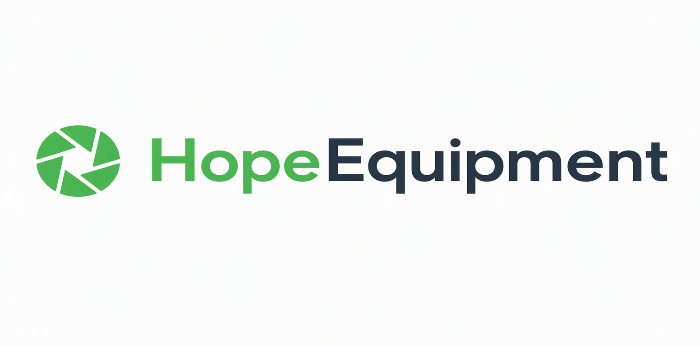

# 04-前端篇

本篇从零搭建 HopeEquipment 的 Vue 3 前端。我们将从项目初始化开始，逐步构建路由、状态管理、API 层、布局和所有页面。

## 1. 项目初始化

### 1.1 创建 Vite 项目

```bash
npm create vite@latest frontend -- --template vue-ts
cd frontend
npm install
```

### 1.2 安装依赖

```bash
npm install vue-router pinia ant-design-vue @ant-design/icons-vue axios
npm install -D unplugin-vue-components
```

| 依赖 | 作用 |
|------|------|
| `vue-router` | 路由管理 |
| `pinia` | 状态管理 |
| `ant-design-vue` | UI 组件库 |
| `@ant-design/icons-vue` | 图标库 |
| `axios` | HTTP 客户端 |
| `unplugin-vue-components` | 组件自动导入（按需加载） |

**`package.json` 全文：**

```json
// frontend/package.json (L1-L26)
{
  "name": "hope-equipment-frontend",
  "private": true,
  "version": "0.0.0",
  "type": "module",
  "scripts": {
    "dev": "vite",
    "build": "vue-tsc -b && vite build",
    "preview": "vite preview"
  },
  "dependencies": {
    "@ant-design/icons-vue": "^7.0.1",
    "ant-design-vue": "^4.2.6",
    "axios": "^1.7.9",
    "pinia": "^4.1.0",
    "vue": "^3.5.13",
    "vue-router": "^5.4.0"
  },
  "devDependencies": {
    "@vitejs/plugin-vue": "^6.0.10",
    "typescript": "~6.0.0",
    "unplugin-vue-components": "^32.1.0",
    "vite": "^8.3.5",
    "vue-tsc": "^3.3.13"
  }
}
```

几点说明：

- **`"private": true`（`L3`）** — npm 拒绝发布私有包，防止把内部项目推到 registry。
- **`"type": "module"`（`L5`）** — 整个包按 ESM 解析，`vite.config.ts` 里才能直接写 `import` 和 `fileURLToPath`。
- **`"build": "vue-tsc -b && vite build"`（`L8`）** — 顺序是「先类型检查，再打包」。Vite 自己转译 TS 时**不做类型检查**（只剥离类型），所以 `vue-tsc` 是这个项目唯一的类型防线；类型有错，`&&` 右边就不会执行，不会产出一个「类型其实不通过」的 `dist/`。
- **`dependencies` / `devDependencies` 分得很干净**（`L11-L18`、`L19-L25`）：运行时要的（Vue、Router、Pinia、Ant Design Vue 及图标包、Axios）在前者，只在构建期要的（Vite、`@vitejs/plugin-vue`、TypeScript、`vue-tsc`、`unplugin-vue-components`）在后者。
- **版本前缀**：只有 `typescript` 用 `~`（锁在 `6.0.x`，只接受补丁），其余都是 `^`（接受次版本）。TypeScript 与 `vue-tsc` 的版本耦合最紧，所以单独收紧。
- **没有额外的样式依赖**：样式全部写在组件的 `<style scoped>` 里，Ant Design Vue 的按需引入由 `unplugin-vue-components` 负责（见 1.3 节）。

### 1.3 Vite 配置

```typescript
// frontend/vite.config.ts (L1-L34)
import { fileURLToPath, URL } from 'node:url'

import vue from '@vitejs/plugin-vue'
import Components from 'unplugin-vue-components/vite'
import { AntDesignVueResolver } from 'unplugin-vue-components/resolvers'
import { defineConfig } from 'vite'

export default defineConfig({
  plugins: [
    vue(),
    Components({
      dts: 'src/components.d.ts',
      resolvers: [
        AntDesignVueResolver({
          importStyle: false,
        }),
      ],
    }),
  ],
  resolve: {
    alias: {
      '@': fileURLToPath(new URL('./src', import.meta.url)),
    },
  },
  server: {
    port: 5173,
    proxy: {
      '/api': {
        target: 'http://localhost:8000',
        changeOrigin: true,
      },
    },
  },
})
```

关键配置说明：

- **`Components`** — 自动导入 Ant Design Vue 组件，无需手动 `import { Button } from 'ant-design-vue'`，在模板中直接用 `<a-button>` 即可
- **`importStyle: false`** — 不自动导入组件样式（我们在 `main.ts` 中全量导入 `reset.css`）
- **`dts: 'src/components.d.ts'`** — 插件在开发/构建过程中扫描模板里用到的组件标签，自动生成这个文件，把「哪个标签对应哪个模块的哪个导出」写成一份 `declare module 'vue'` 的 `GlobalComponents` 接口，让 `<a-button>` 这类没写 `import` 的标签在 `vue-tsc` 眼里仍然是有类型的。它是生成物：文件顶部就写着 `// @ts-nocheck`（`L2`）和 `// Generated by unplugin-vue-components`（`L6`），内容随模板里用到的标签自动增减（`AAvatar`…`ATag` 共 35 个 antd 组件，加上 `EquipmentFormModal`、`PasswordChangeModal` 两个本项目组件，以及 `RouterLink`、`RouterView`），**不要手写**——手改会在下一次构建时被覆盖，所以本篇也不贴它。
- **`@` 别名** — `@/xxx` 指向 `src/xxx`
- **`proxy`** — 开发模式下将 `/api` 请求代理到后端 `localhost:8000`

### 1.4 TypeScript 配置

类型检查的行为由 `tsconfig.json` 决定。这份配置基本沿用 Vite 的 Vue-TS 模板默认值，逐项的理由见下表。

```json
// frontend/tsconfig.json (L1-L20)
{
  "compilerOptions": {
    "target": "ES2020",
    "useDefineForClassFields": true,
    "module": "ESNext",
    "lib": ["ES2020", "DOM", "DOM.Iterable"],
    "skipLibCheck": true,
    "moduleResolution": "bundler",
    "allowImportingTsExtensions": true,
    "isolatedModules": true,
    "moduleDetection": "force",
    "noEmit": true,
    "jsx": "preserve",
    "strict": true,
    "noUnusedLocals": false,
    "noUnusedParameters": false,
    "noFallthroughCasesInSwitch": true
  },
  "include": ["src/**/*.ts", "src/**/*.tsx", "src/**/*.vue"]
}
```

| 配置项 | 行号 | 为什么这样设 |
|--------|------|--------------|
| `noEmit: true` | `L12` | 产物由 Vite 生成，`tsc` / `vue-tsc` 只检查不落盘。也正因为如此，`allowImportingTsExtensions`（`L9`）才合法——默认情况下写 `import './x.ts'` 会报错，因为编译器无法输出同名文件。 |
| `moduleResolution: "bundler"` | `L8` | 按打包器的规则解析模块（支持 `exports` 字段、可省略扩展名），与 Vite 行为一致；用 `node` / `node16` 会和 Vite 解析出不同结果。 |
| `strict: true` | `L14` | 打开 `noImplicitAny`、`strictNullChecks` 等一揽子严格项。本教程反复出现的 `?.`、`!`、`record.role as string` 就是为了在这一档下通过检查。 |
| `isolatedModules` + `moduleDetection: "force"` | `L10-L11` | 保证每个文件都能被单独转译（esbuild 的前提），也是「纯类型导入必须写 `import type`」的由来——`MainLayout.vue` 的 `import type { MenuProps }`（`L67`）、`Camera.vue` 的 `import type { FormField }`（`L67`）都遵守了这一点。 |
| `noUnusedLocals` / `noUnusedParameters` = `false` | `L15-L16` | 有意放松：迭代 UI 时临时留下的未用变量不该直接让构建失败；其余严格检查照旧。 |
| `skipLibCheck: true` | `L7` | 不逐个审查第三方 `.d.ts`，否则 Ant Design Vue 自身的类型问题会变成你的构建错误。 |
| `include` | `L19` | 必须包含 `src/**/*.vue`，否则 `<script setup lang="ts">` 里的代码根本不参与检查，`vue-tsc` 就形同虚设。 |
| `target` / `lib` / `module` / `jsx` / `useDefineForClassFields` | `L3-L6`、`L13` | 模板默认：ES2020 语法 + DOM 类型库 + ESNext 模块 + 不转换 JSX + 按 ES2022 语义处理类字段。没有特殊需求就别动。 |

**`src/env.d.ts`（全文一行）：**

```typescript
// frontend/src/env.d.ts (L1-L1)
/// <reference types="vite/client" />
```

`env.d.ts` 只有一行，但不能少：`/// <reference types="vite/client" />` 让 TypeScript 认识 `import.meta.env`、`*.vue` 组件模块，以及图片等静态资源的 import 形式。它必须放在 `src/` 下——`tsconfig.json` 的 `include` 只覆盖 `src/**`（`L19`）。

## 2. 入口文件

### 2.1 main.ts

```typescript
// frontend/src/main.ts (L1-L13)
import { createApp } from 'vue'
import { createPinia } from 'pinia'
import Antd from 'ant-design-vue'
import 'ant-design-vue/dist/reset.css'

import App from './App.vue'
import { router } from './router'

const app = createApp(App)
app.use(createPinia())
app.use(router)
app.use(Antd)
app.mount('#app')
```

启动顺序：
1. 创建 Vue 应用实例
2. 注册 Pinia（状态管理）
3. 注册 Vue Router（路由）
4. 注册 Ant Design Vue（全量注册，所有组件可用）
5. 挂载到 `#app`

### 2.2 App.vue

```vue
<!-- frontend/src/App.vue (L1-L25) -->
<template>
  <a-config-provider :locale="zhCN">
    <RouterView />
  </a-config-provider>
</template>

<script setup lang="ts">
import { RouterView } from 'vue-router'
import zhCN from 'ant-design-vue/es/locale/zh_CN'
</script>

<style>
.ant-table-tbody > tr:nth-child(even) {
  background-color: #e6f4ff;
}

.ant-table-tbody > tr:nth-child(even) > .ant-table-cell-fix-right {
  background-color: #e6f4ff;
}

.ant-table-tbody > tr.ant-table-row:hover > td,
.ant-table-tbody > tr > td.ant-table-cell-row-hover {
  background-color: unset !important;
}
</style>
```

- **`a-config-provider`** — Ant Design 的全局配置组件，`:locale="zhCN"` 将所有组件的默认文本设为中文（如日期选择器的"确定"、"取消"）
- **全局样式** — 表格偶数行蓝色斑马纹，悬停时取消行高亮（避免与斑马纹冲突）

### 2.3 index.html

```html
<!-- frontend/index.html (L1-L12) -->
<!DOCTYPE html>
<html lang="zh-CN">
  <head>
    <meta charset="UTF-8" />
    <meta name="viewport" content="width=device-width, initial-scale=1.0" />
    <link rel="icon" type="image/x-icon" href="/src/assets/favicon.ico" /><title>设备管理系统</title>
  </head>
  <body>
    <div id="app"></div>
    <script type="module" src="/src/main.ts"></script>
  </body>
</html>
```

`lang="zh-CN"` 确保浏览器和搜索引擎识别页面语言。

## 3. 路由与导航守卫 — router.ts

路由定义了应用的页面结构和访问控制。

### 3.1 路由定义

```typescript
// frontend/src/router.ts (L1-L72)
import { createRouter, createWebHistory } from 'vue-router'

import MainLayout from './layouts/MainLayout.vue'
import { getSetupStatus } from './api'
import { useAuthStore } from './stores/auth'

export const router = createRouter({
  history: createWebHistory(),
  routes: [
    {
      path: '/setup',
      name: 'setup',
      component: () => import('./pages/Setup.vue'),
      meta: { guest: true },
    },
    {
      path: '/login',
      name: 'login',
      component: () => import('./pages/Login.vue'),
      meta: { guest: true },
    },
    {
      path: '/forbidden',
      name: 'forbidden',
      component: () => import('./pages/Forbidden.vue'),
      meta: { public: true },
    },
    {
      path: '/',
      component: MainLayout,
      meta: { requiresAuth: true },
      children: [
        {
          path: '',
          name: 'dashboard',
          component: () => import('./pages/Dashboard.vue'),
          meta: { title: '总览' },
        },
        {
          path: 'camera',
          name: 'camera',
          component: () => import('./pages/Camera.vue'),
          meta: { title: '相机管理' },
        },
        {
          path: 'camcorder',
          name: 'camcorder',
          component: () => import('./pages/Camcorder.vue'),
          meta: { title: '摄像机管理' },
        },
        {
          path: 'lens',
          name: 'lens',
          component: () => import('./pages/Lens.vue'),
          meta: { title: '镜头管理' },
        },
        {
          path: 'accessory',
          name: 'accessory',
          component: () => import('./pages/Accessory.vue'),
          meta: { title: '配件管理' },
        },
        {
          path: 'users',
          name: 'users',
          component: () => import('./pages/Users.vue'),
          meta: { title: '用户管理', minRole: 'admin' },
        },
      ],
    },
  ],
})
```

文件顶部（`L1-L5`）有三个导入值得注意：`MainLayout` 是**静态导入**（首屏就要渲染外壳），页面组件全部**动态导入**；`getSetupStatus` 与 `useAuthStore` 则是给下一节的导航守卫用的。

**路由结构：**

| 路径 | 页面 | 访问条件 |
|------|------|----------|
| `/setup` | 初始化管理员 | 仅未登录（`guest: true`） |
| `/login` | 登录页 | 仅未登录 |
| `/forbidden` | 403 页面 | 公开（`public: true`） |
| `/` | 仪表盘 | 需要登录（`requiresAuth: true`） |
| `/camera` | 相机管理 | 需要登录，在 MainLayout 内 |
| `/camcorder` | 摄像机管理 | 同上 |
| `/lens` | 镜头管理 | 同上 |
| `/accessory` | 配件管理 | 同上 |
| `/users` | 用户管理 | 需要登录 + admin 角色（`minRole: 'admin'`） |

**懒加载**：所有页面组件使用 `() => import(...)` 动态导入，Vite 会自动进行代码分割，每个页面是独立的 JS chunk，只在访问时加载。

**嵌套路由**：`/` 下的子路由都包裹在 `MainLayout` 中，共享侧边栏和顶栏。

### 3.2 导航守卫

```typescript
// frontend/src/router.ts (L74-L119)
let setupChecked = false
let setupDone = false

router.beforeEach(async (to) => {
  if (to.meta.public) {
    return true
  }

  const authStore = useAuthStore()
  await authStore.loadUser()

  if (!setupChecked) {
    setupChecked = true
    try {
      const { setup_done } = await getSetupStatus()
      setupDone = setup_done
    } catch {
      setupDone = true
    }
  }

  if (authStore.isAuthenticated) {
    setupDone = true
  }

  if (!setupDone && to.name !== 'setup') {
    return { name: 'setup' }
  }

  if (to.meta.guest) {
    if (authStore.isAuthenticated) {
      return { name: 'dashboard' }
    }
    return true
  }

  if (to.meta.requiresAuth && !authStore.isAuthenticated) {
    return { name: 'login', query: { redirect: to.fullPath } }
  }

  if (to.meta.minRole && !authStore.hasRole(to.meta.minRole as string)) {
    return { name: 'forbidden' }
  }

  return true
})
```

**守卫逻辑（按优先级）：**

1. **公开页面**（`public: true`）→ 直接放行
2. **加载用户信息** — 调用 `authStore.loadUser()` 恢复登录状态
3. **检查初始化** — 首次导航时调用 `/api/auth/setup-status`，未初始化则强制跳转 Setup
4. **已登录用户** — 如果已认证，标记 setup 已完成（跳过后续检查）
5. **未初始化** → 跳转 `/setup`
6. **访客页面**（`guest: true`）— 已登录则跳转仪表盘，否则放行
7. **需要登录**（`requiresAuth`）— 未登录则跳转 `/login`，并携带 `redirect` 参数（登录后跳回原页面）
8. **角色检查**（`minRole`）— 权限不足则跳转 `/forbidden`

## 4. 状态管理 — stores/auth.ts

使用 Pinia 管理认证状态。

### 4.1 完整代码

```typescript
// frontend/src/stores/auth.ts (L1-L65)
import { defineStore } from 'pinia'
import { computed, ref } from 'vue'
import { getMyInfo, login as loginApi, logout as logoutApi, setup as setupApi, type UserInfo } from '../api'
import { router } from '../router'

const ROLE_LEVEL: Record<string, number> = { user: 1, admin: 2, super_admin: 3 }

export const useAuthStore = defineStore('auth', () => {
  const user = ref<UserInfo | null>(null)
  const authLoaded = ref(false)

  const isAuthenticated = computed(() => !!user.value)
  const role = computed(() => user.value?.role ?? '')
  const roleLevel = computed(() => ROLE_LEVEL[role.value] ?? 0)
  const canDelete = computed(() => roleLevel.value >= 2)
  const canManageUsers = computed(() => roleLevel.value >= 2)

  async function loadUser() {
    if (authLoaded.value) return
    try {
      user.value = await getMyInfo()
    } catch {
      user.value = null
    } finally {
      authLoaded.value = true
    }
  }

  async function login(name: string, password: string) {
    user.value = await loginApi(name, password)
  }

  async function setup(password: string) {
    user.value = await setupApi(password)
  }

  async function logout() {
    try {
      await logoutApi()
    } finally {
      user.value = null
      authLoaded.value = false
      router.push('/login')
    }
  }

  function hasRole(minRole: string): boolean {
    return roleLevel.value >= (ROLE_LEVEL[minRole] ?? 0)
  }

  return {
    user,
    authLoaded,
    isAuthenticated,
    role,
    roleLevel,
    canDelete,
    canManageUsers,
    loadUser,
    login,
    setup,
    logout,
    hasRole,
  }
})
```

### 4.2 设计说明

**使用 Composition API 风格**（`setup` 函数），而非 Options 风格。`defineStore` 接收一个函数，返回 store 实例。

**状态：**
- `user` — 当前用户信息（null 表示未登录）
- `authLoaded` — 是否已尝试加载用户信息（防止重复请求 `/api/auth/me`）

**计算属性：**
- `isAuthenticated` — 是否已登录
- `role` / `roleLevel` — 当前角色和对应数字等级
- `canDelete` — 是否可以删除设备（admin 及以上）
- `canManageUsers` — 是否可以管理用户（admin 及以上）

**动作：**
- `loadUser()` — 调用 `/api/auth/me` 恢复登录状态，只执行一次
- `login()` / `setup()` — 登录/初始化后，将返回的用户信息存入 `user`
- `logout()` — 调用 API 后清除状态，跳转登录页
- `hasRole()` — 检查是否拥有指定角色权限

## 5. API 层 — api.ts

所有后端请求都封装在 `api.ts` 中。

### 5.1 Axios 实例

```typescript
// frontend/src/api.ts (L1-L8)
import axios from 'axios'
import { message } from 'ant-design-vue'

export const http = axios.create({
  baseURL: '',
  timeout: 15000,
  withCredentials: true,
})
```

- `baseURL: ''` — 使用相对路径，开发时由 Vite 代理，生产时同源
- `withCredentials: true` — 携带 Cookie（Session 认证必需）

### 5.2 TypeScript 接口

```typescript
// frontend/src/api.ts (L10-L41)
export interface UserInfo {
  id: string
  name: string
  student_id: string
  grade: string
  college: string
  role: string
  is_active: number
}

export interface CreateUserPayload {
  name: string
  student_id: string
  grade: string
  college: string
  password: string
  role: string
}

export interface EquipmentRecord {
  id: string
  serial: string
  brand: string
  brand_id: string
  hope_id: string
  location: string
  fee_source: string
  status: string
  mount?: string
  ref_id?: string
  acc_type?: string
}
```

`EquipmentRecord` 是 4 类设备的通用接口。`mount`、`ref_id`、`acc_type` 是可选的——不同设备表有不同的字段，用一个接口统一表示。

### 5.3 响应拦截器

```typescript
// frontend/src/api.ts (L43-L55)
http.interceptors.response.use(
  (response) => response,
  (error) => {
    if (error.response?.status === 401) {
      const path = window.location.pathname
      if (path !== '/login' && path !== '/setup') {
        const redirectPath = path + window.location.search
        window.location.href = `/login?redirect=${encodeURIComponent(redirectPath)}`
      }
    }
    return Promise.reject(error)
  },
)
```

全局拦截 401 响应：如果后端返回"未登录"，自动跳转到登录页。这处理了 Session 过期的情况——用户正在操作时 Session 到期，下一次请求返回 401，自动跳转登录。

### 5.4 API 函数

```typescript
// frontend/src/api.ts (L57-L129)
export async function getSetupStatus(): Promise<{ setup_done: boolean }> {
  const { data } = await http.get('/api/auth/setup-status')
  return data
}

export async function setup(password: string): Promise<UserInfo> {
  const { data } = await http.post('/api/auth/setup', { password })
  return data
}

export async function login(name: string, password: string): Promise<UserInfo> {
  const { data } = await http.post('/api/auth/login', { name, password })
  return data
}

export async function logout(): Promise<void> {
  await http.post('/api/auth/logout')
}

export async function getMyInfo(): Promise<UserInfo> {
  const { data } = await http.get('/api/auth/me')
  return data
}

export async function getUsers(): Promise<UserInfo[]> {
  const { data } = await http.get('/api/users')
  return data
}

export async function createUser(payload: CreateUserPayload): Promise<UserInfo> {
  const { data } = await http.post('/api/users', payload)
  return data
}

export async function updateUser(id: string, payload: Partial<CreateUserPayload>): Promise<UserInfo> {
  const { data } = await http.put(`/api/users/${id}`, payload)
  return data
}

export async function deleteUser(id: string): Promise<void> {
  await http.delete(`/api/users/${id}`)
}

export async function toggleUserActive(id: string): Promise<UserInfo> {
  const { data } = await http.put(`/api/users/${id}/toggle-active`)
  return data
}

export async function changeMyPassword(oldPassword: string, newPassword: string): Promise<void> {
  await http.put('/api/users/me/password', {
    old_password: oldPassword,
    new_password: newPassword,
  })
}

export async function listEquipments(table: string): Promise<EquipmentRecord[]> {
  const { data } = await http.get<EquipmentRecord[]>(`/api/${table}`)
  return data
}

export async function createEquipment(table: string, payload: Record<string, string>): Promise<EquipmentRecord> {
  const { data } = await http.post<EquipmentRecord>(`/api/${table}`, payload)
  return data
}

export async function updateEquipment(table: string, id: string, payload: Record<string, string>): Promise<EquipmentRecord> {
  const { data } = await http.put<EquipmentRecord>(`/api/${table}/${id}`, payload)
  return data
}

export async function deleteEquipment(table: string, id: string): Promise<void> {
  await http.delete(`/api/${table}/${id}`)
}
```

设备 CRUD 是**通用的**——传入 `table` 参数（`'camera'`、`'lens'` 等），自动拼接对应的 API 路径。这样 4 个设备管理页面可以复用同一套 API 函数。

函数虽然多，写法完全一致，抓住三点即可：

| 分组 | 行号 | 说明 |
|------|------|------|
| 认证 | `L57-L79` | `getSetupStatus` / `setup` / `login` / `logout` / `getMyInfo`，对应后端 `/api/auth/*` |
| 用户 | `L81-L110` | 5 个用户管理函数 + `changeMyPassword`（`L105-L110`，注意提交的是 snake_case 的 `old_password`/`new_password`，与后端 Pydantic 模型字段一致） |
| 设备 | `L112-L129` | 4 个函数，路径由 `` `/api/${table}` `` 拼出，`listEquipments` 用 `http.get<EquipmentRecord[]>` 显式指定泛型，返回值就是数组 |

- **返回体一律 `const { data } = await ...` 再 `return data`** —— Axios 响应对象里我们只要 body，泛型由函数签名声明。
- **无返回值的写 `Promise<void>` + `await`**（`logout` `L72-L74`、`deleteUser` `L96-L98`、`deleteEquipment` `L127-L129`）。
- **URL 里的 `id` 用模板字符串插值**，后端路由 `/api/users/{user_id}` 一一对应。

### 5.5 请求反馈封装

```typescript
// frontend/src/api.ts (L131-L148)
export async function requestWithFeedback<T>(action: () => Promise<T>, successText?: string): Promise<T> {
  try {
    const result = await action()
    if (successText) {
      message.success(successText)
    }
    return result
  } catch (error: unknown) {
    let msg = '请求失败'
    if (axios.isAxiosError(error)) {
      msg = (error.response?.data as { detail?: string })?.detail || msg
    } else if (error instanceof Error) {
      msg = error.message
    }
    message.error(msg)
    throw error
  }
}
```

`requestWithFeedback` 是一个通用包装器：
- 成功时显示 `message.success`（如果提供了 `successText`）
- 失败时自动提取后端的错误信息（`error.response.data.detail`）并显示 `message.error`
- 所有 CRUD 操作都通过它包装，统一处理成功/失败提示

## 6. 布局 — layouts/MainLayout.vue

MainLayout 是登录后的主框架：左侧导航 + 顶部栏 + 内容区。

### 6.1 模板结构

```vue
<!-- frontend/src/layouts/MainLayout.vue (L1-L63) -->
<template>
  <a-layout class="layout">
    <a-layout-sider
      v-model:collapsed="collapsed"
      :width="200"
      :collapsed-width="64"
      theme="dark"
    >
      <div class="brand">
        <CameraOutlined />
        <span v-show="!collapsed">HopeEquipment</span>
      </div>
      <a-menu
        theme="dark"
        mode="inline"
        :selected-keys="[activeKey]"
        :items="menuItems"
        @click="handleMenuClick"
      />
    </a-layout-sider>

    <a-layout>
      <a-layout-header class="header">
        <a-button type="text" @click="collapsed = !collapsed">
          <MenuUnfoldOutlined v-if="collapsed" />
          <MenuFoldOutlined v-else />
        </a-button>
        <a-breadcrumb>
          <a-breadcrumb-item>管理后台</a-breadcrumb-item>
          <a-breadcrumb-item>{{ route.meta.title || '总览' }}</a-breadcrumb-item>
        </a-breadcrumb>
        <div class="header-right">
          <a-dropdown>
            <span class="user-info">
              <a-avatar :size="28" style="background-color: #1677ff">
                {{ authStore.user?.name?.charAt(0)?.toUpperCase() }}
              </a-avatar>
              <span class="user-name">{{ authStore.user?.name }}</span>
              <a-tag :color="roleColor" size="small">{{ roleLabel }}</a-tag>
            </span>
            <template #overlay>
              <a-menu>
                <a-menu-item key="password" @click="passwordModalOpen = true">修改密码</a-menu-item>
                <a-menu-divider />
                <a-menu-item key="logout" @click="authStore.logout()">退出登录</a-menu-item>
              </a-menu>
            </template>
          </a-dropdown>
          
        </div>
      </a-layout-header>

      <a-layout-content class="content">
        <RouterView />
      </a-layout-content>
    </a-layout>

    <PasswordChangeModal
      :open="passwordModalOpen"
      @close="passwordModalOpen = false"
    />
  </a-layout>
</template>
```

**布局层次：**

```
a-layout (整体，height: 100vh)
├── a-layout-sider (左侧导航，可折叠)
│   ├── brand (Logo + 系统名称)
│   └── a-menu (导航菜单)
└── a-layout (右侧)
    ├── a-layout-header (顶部栏)
    │   ├── 折叠按钮
    │   ├── 面包屑
    │   └── 用户信息 + 下拉菜单
    └── a-layout-content (内容区)
        └── RouterView (子路由页面)
```

### 6.2 脚本 setup：状态、菜单与角色标签

这一段是 MainLayout 的全部逻辑，可以按四组来看：

| 分组 | 行号 | 说明 |
|------|------|------|
| 导入 | `L66-L71` | 8 个图标一次性从 `@ant-design/icons-vue` 导入；`MenuProps` 用 `import type`，编译后不留在产物里 |
| 状态 | `L73-L77` | `route` / `router` / `authStore` 三个组合式函数 + 两个 `ref`：侧边栏折叠位 `collapsed`、改密弹窗开关 `passwordModalOpen` |
| 菜单 | `L79-L100` | `menuItems`（角色动态）与 `menuPaths`（key → 路由路径） |
| 高亮与跳转 | `L102-L113` | `activeKey` 反查当前路径该高亮哪个菜单，`handleMenuClick` 正向跳转 |
| 角色标签 | `L115-L121` | `roleColor` / `roleLabel` 两个 computed，直接拿角色字符串当字典键查 |

几个值得注意的写法：

- **菜单项根据用户角色动态生成**——`authStore.canManageUsers` 为真才 `items.push` 出"用户"这一项（`L87-L89`），普通用户看不到入口。
- **图标是函数而不是组件**：`icon: () => h(DashboardOutlined)`。Ant Design Vue 的 `a-menu` `items` 要求图标渲染函数，`h()` 正好提供。
- **`activeKey` 用「取第一段路径」反查**（`L103`）：`/camera/xxx` 归一成 `/camera`，再用 `Object.entries(menuPaths).find` 找到对应 key；找不到兜底 `'dashboard'`。这样刷新深层路径也不会丢高亮。
- **`handleMenuClick` 先判重再跳**（`L110`）：`path !== route.path` 才 `router.push`，避免点当前页产生一条无意义的历史记录。
- **角色字典查不到时用 `??` 兜底**（`L116`、`L120`），后端将来加角色不会让页面白屏。

```vue
<!-- frontend/src/layouts/MainLayout.vue (L65-L122) -->
<script setup lang="ts">
import { CameraOutlined, DashboardOutlined, MenuFoldOutlined, MenuUnfoldOutlined, PictureOutlined, TeamOutlined, ToolOutlined, VideoCameraOutlined } from '@ant-design/icons-vue'
import type { MenuProps } from 'ant-design-vue'
import { computed, h, ref } from 'vue'
import { useRoute, useRouter } from 'vue-router'
import { useAuthStore } from '../stores/auth'
import PasswordChangeModal from '../components/PasswordChangeModal.vue'

const route = useRoute()
const router = useRouter()
const authStore = useAuthStore()
const collapsed = ref(false)
const passwordModalOpen = ref(false)

const menuItems = computed(() => {
  const items = [
    { key: 'dashboard', label: '总览', icon: () => h(DashboardOutlined) },
    { key: 'camera', label: '相机', icon: () => h(CameraOutlined) },
    { key: 'camcorder', label: '摄像机', icon: () => h(VideoCameraOutlined) },
    { key: 'lens', label: '镜头', icon: () => h(PictureOutlined) },
    { key: 'accessory', label: '配件', icon: () => h(ToolOutlined) },
  ]
  if (authStore.canManageUsers) {
    items.push({ key: 'users', label: '用户', icon: () => h(TeamOutlined) })
  }
  return items
})

const menuPaths: Record<string, string> = {
  dashboard: '/',
  camera: '/camera',
  camcorder: '/camcorder',
  lens: '/lens',
  accessory: '/accessory',
  users: '/users',
}

const activeKey = computed(() => {
  const path = route.path === '/' ? '/' : `/${route.path.split('/')[1]}`
  const entry = Object.entries(menuPaths).find(([, p]) => p === path)
  return entry?.[0] ?? 'dashboard'
})

const handleMenuClick: MenuProps['onClick'] = ({ key }) => {
  const path = menuPaths[key as string]
  if (path && path !== route.path) {
    router.push(path)
  }
}

const roleColor = computed(() => {
  return { super_admin: 'red', admin: 'blue', user: 'green' }[authStore.role] ?? 'default'
})

const roleLabel = computed(() => {
  return { super_admin: '超级管理员', admin: '管理员', user: '用户' }[authStore.role] ?? authStore.role
})
</script>
```

### 6.3 仅内容区滚动

```vue
<!-- frontend/src/layouts/MainLayout.vue (L124-L188) -->
<style scoped>
.layout {
  height: 100vh;
  overflow: hidden;
}

.layout > .ant-layout {
  display: flex;
  flex-direction: column;
  overflow: hidden;
}

.brand {
  display: flex;
  align-items: center;
  justify-content: center;
  gap: 8px;
  height: 64px;
  color: #fff;
  font-size: 18px;
  font-weight: 600;
  border-bottom: 1px solid rgba(255, 255, 255, 0.1);
}

.header-logo {
  height: 32px;
  margin-left: 16px;
}

.header {
  display: flex;
  align-items: center;
  gap: 16px;
  background: #fff;
  padding: 0 24px;
  box-shadow: 0 1px 4px rgba(0, 0, 0, 0.08);
}

.header-right {
  display: flex;
  align-items: center;
  margin-left: auto;
}

.user-info {
  display: flex;
  align-items: center;
  gap: 8px;
  cursor: pointer;
}

.user-name {
  font-size: 14px;
}

.content {
  margin: 24px;
  padding: 24px;
  background: #fff;
  border-radius: 8px;
  overflow-y: auto;
  flex: 1;
  min-height: 0;
}
</style>
```

关键技巧：
- 整体 `height: 100vh; overflow: hidden` — 页面不滚动
- 侧边栏和顶栏固定不动
- 内容区 `overflow-y: auto; flex: 1; min-height: 0` — 只有内容区可以滚动
- `.layout > .ant-layout`（`L130-L134`）是滚动链条上不可少的一环：右侧那层 `a-layout` 必须是 `flex-direction: column` + `overflow: hidden`，内容区的 `flex: 1` 才有意义，否则整页会一起撑高
- 其余规则纯外观：`.brand`（`L136-L146`）侧栏顶部品牌区、`.header`（`L153-L160`）顶栏 flex 排布、`.header-right { margin-left: auto }`（`L162-L166`）把用户信息推到最右

## 7. 页面实现

### 7.1 Login.vue — 登录页

登录页采用浮动粒子 + 居中卡片的布局。

```vue
<!-- frontend/src/pages/Login.vue (L1-L23) -->
<template>
  <main class="login-page">
    <div class="login-particles" aria-hidden="true">
      <span v-for="index in 12" :key="index" />
    </div>

    <a-card class="login-card" title="设备管理系统">
      <a-form layout="vertical" @submit.prevent="submit">
        <a-form-item label="账号">
          <a-input v-model:value="username" autocomplete="username" />
        </a-form-item>
        <a-form-item label="密码">
          <a-input-password v-model:value="password" autocomplete="current-password" />
        </a-form-item>
        <a-button type="primary" html-type="submit" block :loading="loading">登录</a-button>
      </a-form>
    </a-card>

    <footer class="login-footer">
      版权所有© &lt;公司名称&gt;&nbsp;&nbsp;|&nbsp;&nbsp;技术支持：&lt;公司名称&gt;&nbsp;&nbsp;|&nbsp;&nbsp;&lt;ICP备案号&gt;
    </footer>
  </main>
</template>
```

模板里四个细节：

- **`<span v-for="index in 12" :key="index" />`（`L4`）** — 粒子只是 12 个空 `span`，位置/大小/动画全交给 CSS 的 `:nth-child`，模板不需要写死数据。
- **`aria-hidden="true"`（`L3`）** — 纯装饰层，读屏软件直接跳过。
- **`@submit.prevent="submit"`（`L8`）** — 表单回车即提交，同时阻止浏览器默认的整页刷新。
- **页脚（`L19-L21`）** 用的是 HTML 实体（`&lt;` `&nbsp;`），发布版里版权主体是 `<公司名称>` / `<ICP备案号>` 占位符。

**样式：居中卡片 + 浮动粒子**

```vue
<!-- frontend/src/pages/Login.vue (L64-L144) -->
<style scoped>
.login-page {
  min-height: 100vh;
  position: relative;
  isolation: isolate;
  display: flex;
  flex-direction: column;
  align-items: center;
  overflow: hidden;
  background: #f5f7fb;
}

.login-card {
  width: min(420px, calc(100vw - 32px));
  margin: auto;
  z-index: 1;
}

.login-particles {
  position: absolute;
  inset: 0;
  z-index: 0;
  pointer-events: none;
}

.login-particles span {
  position: absolute;
  width: 12px;
  height: 12px;
  border-radius: 50%;
  background: #8bc4ff;
  opacity: 0.42;
  animation: login-particle-float 8s ease-in-out infinite alternate;
}

.login-particles span:nth-child(2n) {
  background: #8ee5c8;
}

.login-particles span:nth-child(1) { top: 15%; left: 2%; width: 30px; height: 30px; animation-delay: -4s; }
.login-particles span:nth-child(2) { top: 16%; left: 30%; width: 16px; height: 16px; animation-duration: 7s; }
.login-particles span:nth-child(3) { top: 32%; left: 20%; width: 8px; height: 8px; animation-delay: -8s; }
.login-particles span:nth-child(4) { top: 34%; right: 2%; width: 29px; height: 29px; animation-duration: 10s; }
.login-particles span:nth-child(5) { top: 56%; left: 35%; width: 28px; height: 28px; animation-delay: -12s; }
.login-particles span:nth-child(6) { top: 61%; right: 28%; width: 34px; height: 34px; animation-duration: 7s; }
.login-particles span:nth-child(7) { top: 75%; left: 19%; width: 24px; height: 24px; animation-delay: -6s; }
.login-particles span:nth-child(8) { top: 78%; right: 25%; width: 17px; height: 17px; animation-duration: 9s; }
.login-particles span:nth-child(9) { bottom: 10%; left: 33%; width: 9px; height: 9px; animation-delay: -10s; }
.login-particles span:nth-child(10) { bottom: 13%; right: 5%; width: 29px; height: 29px; animation-duration: 6s; }
.login-particles span:nth-child(11) { bottom: 3%; left: 42%; width: 5px; height: 5px; animation-delay: -2s; }
.login-particles span:nth-child(12) { bottom: -1%; right: 1%; width: 40px; height: 40px; animation-duration: 10s; }

.login-footer {
  position: relative;
  z-index: 1;
  padding: 20px 0;
  color: #8c8c8c;
  font-size: 14px;
}

.login-footer a {
  color: #8c8c8c;
  text-decoration: none;
}

.login-footer a:hover {
  text-decoration: underline;
}

@keyframes login-particle-float {
  to {
    transform: translate(120px, -90px);
  }
}

@media (prefers-reduced-motion: reduce) {
  .login-particles span {
    animation: none;
  }
}
</style>
```

样式分四层，缺一层视觉效果就塌：

| 层 | 行号 | 作用 |
|----|------|------|
| 页面 | `L65-L74` | `min-height: 100vh` + `flex-direction: column` + `align-items: center` 让卡片水平居中；`isolation: isolate` 单独开一个层叠上下文，粒子不会穿到页面之外 |
| 卡片 | `L76-L80` | `width: min(420px, calc(100vw - 32px))` 桌面固定 420px、手机上留 16px 边距；`margin: auto` 是它在纵向 flex 里靠下、页脚贴底的关键；`z-index: 1` 压在粒子上面 |
| 粒子 | `L82-L114` | `.login-particles` 用 `inset: 0` 铺满、`pointer-events: none` 保证不挡点击；12 个 `span` 由 `:nth-child` 逐个指定 `top/left/width/height/animation-delay/animation-duration`，`:nth-child(2n)` 换成绿色，于是蓝绿交替、大小错落 |
| 页脚与动画 | `L116-L143` | 页脚灰色小字 + hover 下划线；`@keyframes login-particle-float` 只写 `to`，配合 `alternate` 上下往返；`prefers-reduced-motion: reduce` 时直接 `animation: none`，尊重系统的减弱动态设置 |

**脚本 setup：初始化检查与登录提交**

```vue
<!-- frontend/src/pages/Login.vue (L25-L62) -->
<script setup lang="ts">
import { computed, onMounted, ref } from 'vue'
import { useRoute, useRouter } from 'vue-router'
import { getSetupStatus, requestWithFeedback } from '../api'
import { useAuthStore } from '../stores/auth'

const route = useRoute()
const router = useRouter()
const authStore = useAuthStore()

const username = ref('')
const password = ref('')
const loading = ref(false)

const redirectPath = computed(() => {
  const value = route.query.redirect
  return typeof value === 'string' && value.startsWith('/') ? value : '/'
})

onMounted(async () => {
  const { setup_done } = await getSetupStatus()
  if (!setup_done) {
    router.replace('/setup')
  }
})

async function submit() {
  await requestWithFeedback(async () => {
    loading.value = true
    try {
      await authStore.login(username.value, password.value)
      await router.replace(redirectPath.value)
    } finally {
      loading.value = false
    }
  }, '登录成功')
}
</script>
```

- **三个 `ref` 就够一个登录页**（`L35-L37`）：账号、密码、按钮 loading。
- **`redirectPath` 是 computed 而不是直接读 `route.query`**（`L39-L42`），并且只接受以 `/` 开头的值——`//evil.com` 这种以协议开头的地址会被判为非法而回落 `/`，防止开放重定向。
- **`onMounted` 先查初始化状态**（`L44-L49`）：系统还没建管理员时直接 `router.replace('/setup')`，用 `replace` 是不让用户点后退又回到登录页。
- **`submit` 整体包在 `requestWithFeedback` 里**（`L51-L61`）：成功提示"登录成功"、失败自动弹出后端 `detail`（"用户名或密码错误"/"账号已锁定"）。
- **`loading` 在 `finally` 里复位**（`L57-L59`）：失败也必须把按钮恢复可点，否则用户没法重试。

### 7.2 Setup.vue — 首次初始化

Setup 页面与 Login 共用同一套视觉（浮动粒子 + 居中卡片），差别只在表单内容和跳转逻辑。它是全项目第一个被访问的页面——数据库还没有管理员时，所有请求都会落到这里。

**模板：**

```vue
<!-- frontend/src/pages/Setup.vue (L1-L26) -->
<template>
  <main class="login-page">
    <div class="login-particles" aria-hidden="true">
      <span v-for="index in 12" :key="index" />
    </div>

    <a-card class="login-card" title="初始化管理员">
      <a-form layout="vertical" @submit.prevent="submit">
        <a-form-item label="用户名">
          <a-input value="admin" disabled />
        </a-form-item>
        <a-form-item label="密码">
          <a-input-password v-model:value="password" autocomplete="new-password" />
        </a-form-item>
        <a-form-item label="确认密码">
          <a-input-password v-model:value="confirmPassword" autocomplete="new-password" />
        </a-form-item>
        <a-button type="primary" html-type="submit" block :loading="loading">创建管理员</a-button>
      </a-form>
    </a-card>

    <footer class="login-footer">
      Hope设备管理系统
    </footer>
  </main>
</template>
```

- **用户名输入框写死 `value="admin"` 且 `disabled`（`L10`）** — 没有 `v-model`，前端不允许改；后端 `/api/auth/setup` 也只创建名为 `admin` 的超级管理员。
- **两个密码框都是 `autocomplete="new-password"`（`L13`、`L16`）** — 明确告诉浏览器这是新密码，不要回填已保存的旧密码。
- **页脚只有系统名，没有版权与备案号（`L22-L24`）** — 初始化页只在第一次部署时出现，不必挂完整页脚。

**脚本 setup：**

```vue
<!-- frontend/src/pages/Setup.vue (L28-L64) -->
<script setup lang="ts">
import { onMounted, ref } from 'vue'
import { useRouter } from 'vue-router'
import { message } from 'ant-design-vue'
import { getSetupStatus, requestWithFeedback } from '../api'
import { useAuthStore } from '../stores/auth'

const router = useRouter()
const authStore = useAuthStore()

const password = ref('')
const confirmPassword = ref('')
const loading = ref(false)

onMounted(async () => {
  const { setup_done } = await getSetupStatus()
  if (setup_done) {
    router.replace('/login')
  }
})

async function submit() {
  if (password.value !== confirmPassword.value) {
    message.warning('两次输入的密码不一致')
    return
  }
  await requestWithFeedback(async () => {
    loading.value = true
    try {
      await authStore.setup(password.value)
      await router.replace('/')
    } finally {
      loading.value = false
    }
  }, '管理员创建成功')
}
</script>
```

- **`onMounted` 的判断与登录页正好相反**（`L42-L47`）：已经初始化过（`setup_done === true`）就 `router.replace('/login')`。所以 Setup 页不是一个"入口"，而是一个"仅当系统为空时可访问"的一次性页面。
- **`message.warning` 直接来自 `ant-design-vue`**（`L31`）：两次密码不一致属于前端就能判定的错误，不需要发请求，因此不走 `requestWithFeedback`。
- **校验失败直接 `return`**（`L52`），不发请求、不置 `loading`。
- **`authStore.setup()` 成功后 `router.replace('/')`**（`L57-L58`）：`setup` 接口在创建管理员的同时就写好了 Session Cookie，所以这里不需要再登录一次。

**样式：**

```vue
<!-- frontend/src/pages/Setup.vue (L66-L137) -->
<style scoped>
.login-page {
  min-height: 100vh;
  position: relative;
  isolation: isolate;
  display: flex;
  flex-direction: column;
  align-items: center;
  overflow: hidden;
  background: #f5f7fb;
}

.login-card {
  width: min(420px, calc(100vw - 32px));
  margin: auto;
  z-index: 1;
}

.login-particles {
  position: absolute;
  inset: 0;
  z-index: 0;
  pointer-events: none;
}

.login-particles span {
  position: absolute;
  width: 12px;
  height: 12px;
  border-radius: 50%;
  background: #8bc4ff;
  opacity: 0.42;
  animation: login-particle-float 8s ease-in-out infinite alternate;
}

.login-particles span:nth-child(2n) {
  background: #8ee5c8;
}

.login-particles span:nth-child(1) { top: 15%; left: 2%; width: 30px; height: 30px; animation-delay: -4s; }
.login-particles span:nth-child(2) { top: 16%; left: 30%; width: 16px; height: 16px; animation-duration: 7s; }
.login-particles span:nth-child(3) { top: 32%; left: 20%; width: 8px; height: 8px; animation-delay: -8s; }
.login-particles span:nth-child(4) { top: 34%; right: 2%; width: 29px; height: 29px; animation-duration: 10s; }
.login-particles span:nth-child(5) { top: 56%; left: 35%; width: 28px; height: 28px; animation-delay: -12s; }
.login-particles span:nth-child(6) { top: 61%; right: 28%; width: 34px; height: 34px; animation-duration: 7s; }
.login-particles span:nth-child(7) { top: 75%; left: 19%; width: 24px; height: 24px; animation-delay: -6s; }
.login-particles span:nth-child(8) { top: 78%; right: 25%; width: 17px; height: 17px; animation-duration: 9s; }
.login-particles span:nth-child(9) { bottom: 10%; left: 33%; width: 9px; height: 9px; animation-delay: -10s; }
.login-particles span:nth-child(10) { bottom: 13%; right: 5%; width: 29px; height: 29px; animation-duration: 6s; }
.login-particles span:nth-child(11) { bottom: 3%; left: 42%; width: 5px; height: 5px; animation-delay: -2s; }
.login-particles span:nth-child(12) { bottom: -1%; right: 1%; width: 40px; height: 40px; animation-duration: 10s; }

.login-footer {
  position: relative;
  z-index: 1;
  padding: 20px 0;
  color: #8c8c8c;
  font-size: 14px;
}

@keyframes login-particle-float {
  to {
    transform: translate(120px, -90px);
  }
}

@media (prefers-reduced-motion: reduce) {
  .login-particles span {
    animation: none;
  }
}
</style>
```

**与 `Login.vue` 样式的唯一差异**：页脚没有链接，因此少了 `.login-footer a` 与 `.login-footer a:hover` 两条规则，其余规则逐行相同。

一个命名细节需要说明：`L23` 的页脚写的是 `Hope设备管理系统`，而 `Login.vue` 卡片标题是"设备管理系统"。这里保留源码原样——`Hope` 是项目自身的英文名（仓库名 `HopeEquipment`、设备表字段 `hope_id` 都来自它），不是厂商品牌，两页的差异属于历史遗留而非脱敏遗漏。

### 7.3 Dashboard.vue — 仪表盘

仪表盘是首页：4 张统计卡片 + 设备卡片网格 + 详情抽屉。模板正好分成三段，与源码里的三个 HTML 注释分节一一对应。

**页头与统计卡片：**

```vue
<!-- frontend/src/pages/Dashboard.vue (L1-L33) -->
<template>
  <div class="page-header">
    <h2>总览</h2>
  </div>

  <!-- 统计卡片 -->
  <a-row :gutter="16" style="margin-bottom: 24px">
    <a-col :span="6" v-for="card in statCards" :key="card.key">
      <a-card :title="card.title" hoverable @click="router.push(card.path)">
        <div class="stat-equation">
          <div class="stat-item">
            <a-tag color="green">正常</a-tag>
            <span class="stat-count stat-count--normal">{{ card.normal }}</span>
          </div>
          <span class="stat-operator">+</span>
          <div class="stat-item">
            <a-tag color="orange">维修</a-tag>
            <span class="stat-count stat-count--repair">{{ card.repair }}</span>
          </div>
          <span class="stat-operator">+</span>
          <div class="stat-item">
            <a-tag color="red">退役</a-tag>
            <span class="stat-count stat-count--retired">{{ card.retired }}</span>
          </div>
          <span class="stat-operator">=</span>
          <div class="stat-item stat-item--total">
            <a-tag color="blue">总计</a-tag>
            <span class="stat-total">{{ card.normal + card.repair + card.retired }}</span>
          </div>
        </div>
      </a-card>
    </a-col>
  </a-row>
```

- **`v-for="card in statCards"`（`L8`）** — 4 张卡片由数据驱动，加一类设备只改脚本里的数组，不动模板。
- **等式格式**（`L10-L30`）：`正常 + 维修 + 退役 = 总计`，标签在上、数字在下（`.stat-item` 是 `flex-direction: column`）。总计不是后端给的，而是模板里现算 `{{ card.normal + card.repair + card.retired }}`（`L28`），保证三项相加永远等于总计。
- **整张卡片是入口**：`hoverable` + `@click="router.push(card.path)"`（`L9`），点统计卡片直达对应的设备管理页。

**设备卡片分组：**

```vue
<!-- frontend/src/pages/Dashboard.vue (L35-L71) -->
  <!-- 设备卡片分组 -->
  <div v-for="group in bodyGroups" :key="group.title" class="section">
    <h2 class="section-title">{{ group.title }}</h2>
    <a-row :gutter="[16, 16]">
      <a-col
        v-for="eq in group.items"
        :key="eq.id"
        :xs="24"
        :sm="12"
        :md="8"
        :lg="6"
      >
        <a-card hoverable class="equipment-card" @click="selected = eq">
          <template #title>
            <div class="card-title-row">
              <div class="card-title-left">
                <a-tag :color="getStatusColor(eq.status)">{{ eq.status }}</a-tag>
                <span class="card-name">{{ eq.brand }} {{ eq.hope_id }}</span>
              </div>
              <div class="card-title-right">
                卡口：{{ eq.mount || '-' }} | 地点：{{ eq.location || '-' }}
              </div>
            </div>
          </template>
          <div class="card-photo-placeholder">
            
            <a-empty v-else description="暂无照片" />
          </div>
        </a-card>
      </a-col>
    </a-row>
  </div>
```

- **首页只铺两组**：`bodyGroups` 这个 computed 里只放了相机与摄像机（见脚本 `L194-L197`），镜头和配件通过抽屉里的关联列表看，避免首页无限长。
- **响应式栅格**（`L39-L46`）：`:xs="24" :sm="12" :md="8" :lg="6"`，即手机 1 列、窄屏 2 列、中屏 3 列、大屏 4 列；`:gutter="[16, 16]"` 是水平和垂直间距都 16px。
- **`#title` 插槽自定义卡片头**（`L48-L58`）：左边状态标签 + 品牌 + 厚朴编号，右边卡口与地点，两头对齐。
- **照片按 `eq.id` 取**（`L59-L67`）：`photoUrl(eq.id)` 命中就显示图片，命不中用 `<a-empty description="暂无照片" />` 兜底，不会留下破图图标。

**详情抽屉：**

```vue
<!-- frontend/src/pages/Dashboard.vue (L73-L151) -->
  <!-- 详情抽屉 -->
  <a-drawer
    :open="!!selected"
    :title="selected ? `${selected.brand} ${selected.hope_id}` : ''"
    :width="600"
    @close="selected = null"
  >
    <template v-if="selected">
      <a-descriptions :column="2" bordered size="small">
        <a-descriptions-item label="品牌">
          {{ selected.brand }}
        </a-descriptions-item>
        <a-descriptions-item label="状态">
          <a-tag :color="getStatusColor(selected.status)">{{ selected.status }}</a-tag>
        </a-descriptions-item>
        <a-descriptions-item label="序列号">{{ selected.serial || '-' }}</a-descriptions-item>
        <a-descriptions-item label="卡口">{{ selected.mount || '-' }}</a-descriptions-item>
        <a-descriptions-item label="厚朴编号">{{ selected.hope_id || '-' }}</a-descriptions-item>
        <a-descriptions-item label="存放地点">{{ selected.location || '-' }}</a-descriptions-item>
      </a-descriptions>

      <a-tabs v-model:activeKey="activeTab" style="margin-top: 24px">
        <a-tab-pane key="lens" :tab="`镜头 (${relatedLenses.length})`">
          <template v-if="relatedLenses.length === 0">
            <a-empty description="暂无关联镜头" />
          </template>
          <template v-else>
            <div v-for="lens in relatedLenses" :key="lens.id" style="margin-bottom: 24px">
              <h3 class="lens-title">{{ lens.brand }} {{ lens.brand_id }}</h3>
              <a-descriptions :column="2" bordered size="small">
                <a-descriptions-item label="品牌">{{ lens.brand }}</a-descriptions-item>
                <a-descriptions-item label="状态">
                  <a-tag :color="getStatusColor(lens.status)">{{ lens.status }}</a-tag>
                </a-descriptions-item>
                <a-descriptions-item label="序列号">{{ lens.serial || '-' }}</a-descriptions-item>
                <a-descriptions-item label="卡口">{{ lens.mount || '-' }}</a-descriptions-item>
                <a-descriptions-item label="厚朴编号">{{ lens.hope_id || '-' }}</a-descriptions-item>
                <a-descriptions-item label="存放地点">{{ lens.location || '-' }}</a-descriptions-item>
              </a-descriptions>
              <div class="lens-photo-placeholder">
                
                <span v-else class="no-photo-text">无图片</span>
              </div>
            </div>
          </template>
        </a-tab-pane>

        <a-tab-pane key="accessory" :tab="`配件 (${relatedAccessories.length})`">
          <template v-if="relatedAccessories.length === 0">
            <a-empty description="暂无关联配件" />
          </template>
          <template v-else>
            <div v-for="group in accessoryGroups" :key="group.type" class="accessory-group">
              <h3 class="accessory-group-title">{{ group.type }}</h3>
              <a-row :gutter="[16, 16]">
                <a-col :span="12" v-for="acc in group.items" :key="acc.id">
                  <a-card hoverable class="accessory-card">
                    <template #title>
                      <div class="acc-title-row">
                        <div class="acc-title-left">
                          <a-tag :color="getStatusColor(acc.status)" size="small">{{ acc.status }}</a-tag>
                          <span class="acc-name">{{ acc.brand }} {{ acc.hope_id }}</span>
                        </div>
                      </div>
                    </template>
                    <div class="acc-photo-placeholder">
                      
                      <span v-else class="no-photo-text">无图片</span>
                    </div>
                  </a-card>
                </a-col>
              </a-row>
            </div>
          </template>
        </a-tab-pane>
      </a-tabs>
    </template>
  </a-drawer>
</template>
```

抽屉宽 600，点遮罩或关闭按钮时 `@close="selected = null"`（`L78`）；整段内容包在 `<template v-if="selected">`（`L80`）里，没选中项时完全不渲染，内部就可以放心写 `selected.brand` 而不是一串可选链。

- 上半部 `a-descriptions`（`L81-L92`）：设备基本信息，两列带边框小尺寸；每个字段都 `|| '-'` 兜底，空值显示横杠而不是空白。
- 下半部 `a-tabs`（`L94-L148`）两个页签，标题里直接带数量：`` :tab="`镜头 (${relatedLenses.length})`" ``。
- 每个页签都是「空列表 → `a-empty`；有数据 → `v-else` 渲染列表」两分支写法（`L96-L99`、`L121-L124`）。
- 关联数据靠 `ref_id` 过滤（见脚本 `L202-L207`），配件再按 `acc_type` 分组（`L125-L145`），每组一个 `a-row` 卡片网格。
- 单个镜头块（`L100-L116`）= 小标题 + 描述表 + 照片占位；无图时显示"无图片"文字（`L114`）。

**脚本 setup：**

```vue
<!-- frontend/src/pages/Dashboard.vue (L153-L227) -->
<script setup lang="ts">
import { computed, onMounted, ref } from 'vue'
import { useRouter } from 'vue-router'

import { listEquipments, type EquipmentRecord } from '../api'
import { getEquipmentPhotoUrl } from '../equipmentPhotos'

const router = useRouter()

const statCards = ref([
  { key: 'camera', title: '相机', path: '/camera', normal: 0, repair: 0, retired: 0 },
  { key: 'camcorder', title: '摄像机', path: '/camcorder', normal: 0, repair: 0, retired: 0 },
  { key: 'lens', title: '镜头', path: '/lens', normal: 0, repair: 0, retired: 0 },
  { key: 'accessory', title: '配件', path: '/accessory', normal: 0, repair: 0, retired: 0 },
])

const cameras = ref<EquipmentRecord[]>([])
const camcorders = ref<EquipmentRecord[]>([])
const lenses = ref<EquipmentRecord[]>([])
const accessories = ref<EquipmentRecord[]>([])

onMounted(async () => {
  const [c, cc, l, a] = await Promise.all([
    listEquipments('camera'),
    listEquipments('camcorder'),
    listEquipments('lens'),
    listEquipments('accessory'),
  ])
  cameras.value = c
  camcorders.value = cc
  lenses.value = l
  accessories.value = a

  const sources = [c, cc, l, a]
  for (const [i, items] of sources.entries()) {
    statCards.value[i].normal = items.filter(e => e.status === '正常').length
    statCards.value[i].repair = items.filter(e => e.status === '维修').length
    statCards.value[i].retired = items.filter(e => e.status === '退役').length
  }
})

const bodyGroups = computed(() => [
  { title: '相机', items: cameras.value },
  { title: '摄像机', items: camcorders.value },
])

const selected = ref<EquipmentRecord | null>(null)
const activeTab = ref('lens')

const relatedLenses = computed(() =>
  selected.value ? lenses.value.filter(l => l.ref_id === selected.value!.id) : []
)
const relatedAccessories = computed(() =>
  selected.value ? accessories.value.filter(a => a.ref_id === selected.value!.id) : []
)

const accessoryGroups = computed(() => {
  if (!selected.value) return []
  const map = new Map<string, EquipmentRecord[]>()
  for (const acc of relatedAccessories.value) {
    const type = acc.acc_type || '其他'
    if (!map.has(type)) map.set(type, [])
    map.get(type)!.push(acc)
  }
  return Array.from(map.entries()).map(([type, items]) => ({ type, items }))
})

function getStatusColor(status: string): string {
  return { '正常': 'green', '维修': 'orange', '退役': 'red' }[status] || 'default'
}

function photoUrl(id: string): string | undefined {
  return getEquipmentPhotoUrl(id)
}
</script>
```

- **一次 `Promise.all` 拉完 4 类设备**（`L175-L180`），不串行 await；解构顺序与请求顺序一致，随后分别赋给 4 个 `ref`（`L181-L184`）。
- **统计由前端算**（`L186-L191`）：`sources` 数组的顺序与 `statCards` 一一对应，用 `entries()` 拿下标把 `normal / repair / retired` 写回。省掉一个专门的统计接口——数据量在百条级时完全够用，这也是本项目一贯的「能前端算就不加接口」取舍。
- **`relatedLenses` / `relatedAccessories` 是 computed**（`L202-L207`）：点开哪台就现算，不需要维护"当前关联列表"这种中间状态。里面的 `selected.value!.id` 用了非空断言，因为外层三目已经判过 `selected.value`，`!` 只是说给 TypeScript 听。
- **`accessoryGroups`（`L209-L218`）** 用 `Map` 按 `acc_type` 聚合，没有类型的落到 `'其他'`，最后 `Array.from(map.entries())` 转成 `{ type, items }` 数组供模板 `v-for`。
- **`getStatusColor`（`L220-L222`）** 把中文状态映射成标签颜色，查不到返回 `default`，将来加新状态不会报错。

**样式：**

```vue
<!-- frontend/src/pages/Dashboard.vue (L229-L427) -->
<style scoped>
.stat-equation {
  display: flex;
  align-items: center;
  justify-content: center;
  gap: 8px;
}

.stat-item {
  display: flex;
  flex-direction: column;
  align-items: center;
  gap: 4px;
  min-width: 70px;
}

.stat-item .ant-tag {
  margin-inline-end: 0;
}

.stat-item--total {
  min-width: 70px;
}

.stat-count {
  font-size: 20px;
  font-weight: 700;
}

.stat-count--normal { color: #52c41a; }
.stat-count--repair { color: #faad14; }
.stat-count--retired { color: #f5222d; }

.stat-operator {
  color: rgba(0, 0, 0, 0.45);
  font-size: 20px;
  font-weight: 500;
}

.stat-total {
  font-size: 20px;
  font-weight: 700;
  color: rgba(0, 0, 0, 0.85);
}

.section {
  margin-bottom: 32px;
}

.section-title {
  font-size: 20px;
  font-weight: 600;
  margin: 0 0 24px 0;
}

.equipment-card {
  cursor: pointer;
  transition: all 0.3s;
}

.equipment-card:hover {
  transform: translateY(-2px);
  box-shadow: 0 4px 12px rgba(0, 0, 0, 0.1);
}

.card-title-row {
  display: flex;
  justify-content: space-between;
  align-items: flex-start;
}

.card-title-left {
  display: flex;
  align-items: center;
  gap: 8px;
}

.card-name {
  font-size: 16px;
  font-weight: 500;
}

.card-title-right {
  text-align: right;
  font-size: 12px;
  color: rgba(0, 0, 0, 0.45);
  line-height: 1.6;
}

.card-photo-placeholder {
  width: 100%;
  aspect-ratio: 4 / 3;
  background: #f5f5f5;
  border-radius: 4px;
  display: flex;
  align-items: center;
  justify-content: center;
  overflow: hidden;
}

.card-photo {
  width: 100%;
  height: 100%;
  object-fit: cover;
}

.lens-photo-placeholder {
  width: 100%;
  aspect-ratio: 4 / 3;
  background: #f5f5f5;
  border-radius: 4px;
  display: flex;
  align-items: center;
  justify-content: center;
  overflow: hidden;
  margin-top: 8px;
}

.lens-photo {
  width: 100%;
  height: 100%;
  object-fit: cover;
}

.lens-title {
  font-size: 16px;
  font-weight: 600;
  margin: 0 0 12px 0;
}

.accessory-group {
  margin-bottom: 24px;
}

.accessory-group-title {
  font-size: 16px;
  font-weight: 600;
  margin: 0 0 12px 0;
}

.accessory-card {
  cursor: pointer;
  transition: all 0.3s;
}

.accessory-card .ant-tag {
  margin-inline-end: 0;
}

.accessory-card:hover {
  transform: translateY(-2px);
  box-shadow: 0 4px 12px rgba(0, 0, 0, 0.1);
}

.acc-title-row {
  display: flex;
  justify-content: space-between;
  align-items: flex-start;
}

.acc-title-left {
  display: flex;
  align-items: center;
  gap: 8px;
}

.acc-name {
  font-size: 14px;
  font-weight: 500;
}

.acc-location {
  text-align: right;
  font-size: 12px;
  color: rgba(0, 0, 0, 0.45);
}

.acc-photo-placeholder {
  width: 100%;
  aspect-ratio: 4 / 3;
  background: #f5f5f5;
  border-radius: 4px;
  display: flex;
  align-items: center;
  justify-content: center;
  overflow: hidden;
}

.acc-photo {
  width: 100%;
  height: 100%;
  object-fit: cover;
}

.no-photo-text {
  color: rgba(0, 0, 0, 0.25);
  font-size: 12px;
}
</style>
```

样式没有魔法，三段值得留意：

- **等式的排版**（`L230-L251`）：`.stat-equation` 用 flex 把「三项加和」横排、`justify-content: center` 居中；`.stat-item` 内部 `flex-direction: column` 才是"标签在上、数字在下"的来源。`.stat-item .ant-tag { margin-inline-end: 0 }`（`L245-L247`）抵消了 Ant Design 标签默认右边距，否则每列间距会一节宽一节窄。
- **三个照片占位同构**：`.card-photo-placeholder`（`L318-L327`）、`.lens-photo-placeholder`（`L335-L345`）、`.acc-photo-placeholder`（`L406-L415`）都是 `aspect-ratio: 4 / 3` 撑出固定比例的框，再配 `object-fit: cover` 裁切，所以照片尺寸不完全一致也不会把卡片撑变形。
- **hover 只动视觉不动布局**：`transform: translateY(-2px)` + 阴影（`L289-L292`、`L378-L381`），用 `transform` 而不是 `margin`，不会引起重排。

### 7.4 Camera.vue — 设备管理页

Camera、Camcorder、Lens、Accessory 四个页面结构几乎相同，只是表名和字段不同。以 Camera 为例，整页 188 行就是「一张表 + 两个弹窗」：

**模板：**

```vue
<!-- frontend/src/pages/Camera.vue (L1-L52) -->
<template>
  <div class="page-header">
    <h2>相机管理</h2>
    <a-button type="primary" @click="openCreate">新增相机</a-button>
  </div>

  <a-table
    :columns="columns"
    :data-source="items"
    :loading="loading"
    :pagination="{ pageSize: 20, showSizeChanger: true }"
    row-key="id"
    :scroll="{ x: 1140 }"
  >
    <template #bodyCell="{ column, record }">
      <template v-if="column.dataIndex === 'status'">
        <a-tag :color="getStatusColor(record.status)">{{ record.status }}</a-tag>
      </template>
      <div v-else-if="column.key === 'actions'" class="table-actions">
        <a-button type="link" size="small" @click="openPreview(record.id)">预览</a-button>
        <a-divider type="vertical" />
        <a-button type="link" size="small" @click="openEdit(record as EquipmentRecord)">编辑</a-button>
        <template v-if="authStore.canDelete">
          <a-divider type="vertical" />
          <a-popconfirm
            :title="`确定删除 ${record.id}？`"
            ok-text="删除"
            cancel-text="取消"
            @confirm="handleDelete(record.id)"
          >
            <a-button type="link" size="small" danger>删除</a-button>
          </a-popconfirm>
        </template>
      </div>
    </template>
  </a-table>

  <EquipmentFormModal
    :open="formOpen"
    :editing="editingItem"
    :submitting="submitting"
    label="相机"
    :form-fields="formFields"
    @close="formOpen = false"
    @submit="handleSave"
  />

  <a-modal :open="previewVisible" :footer="null" @cancel="previewVisible = false">
    
    <a-empty v-else description="暂无照片" />
  </a-modal>
</template>
```

模板分四块，顺序就是页面上从上到下的顺序：

- **页头（`L2-L5`）** — 标题 + 「新增相机」按钮，`.page-header` 用 flex 把它们推到两端。
- **表格（`L7-L36`）** — `#bodyCell` 插槽是唯一的重写点：`column.dataIndex === 'status'` 走彩色标签分支（`L16-L18`），`column.key === 'actions'` 走操作按钮分支（`L19-L34`），其余列全部用默认渲染。删除按钮整个包在 `<template v-if="authStore.canDelete">` 里（`L23`），没权限的人连按钮都看不到。
- **`a-popconfirm` 写成多行（`L25-L30`）** — 因为 `ok-text="删除"` / `cancel-text="取消"` 要覆盖默认的「确定/取消」；二次确认的文案用 `` `确定删除 ${record.id}？` `` 直接带上 ID，删错了能立刻发现是哪条。
- **新增/编辑弹窗（`L38-L46`）** — 只传 props 和两个事件，表单长什么样完全由 `formFields` 决定（见 8.1 节）。
- **照片预览弹窗（`L48-L51`）** — `:footer="null"` 去掉确定/取消按钮，纯看图；无图时同样是 `a-empty` 兜底。

**脚本① 导入、状态、辅助函数与列定义：**

```vue
<!-- frontend/src/pages/Camera.vue (L54-L102) -->
<script setup lang="ts">
import { onMounted, ref } from 'vue'

import {
  listEquipments,
  createEquipment,
  updateEquipment,
  deleteEquipment,
  requestWithFeedback,
  type EquipmentRecord,
} from '../api'
import { getEquipmentPhotoUrl } from '../equipmentPhotos'
import EquipmentFormModal from '../components/EquipmentFormModal.vue'
import type { FormField } from '../components/EquipmentFormModal.vue'
import { useAuthStore } from '../stores/auth'

const authStore = useAuthStore()

const TABLE = 'camera'

const loading = ref(false)
const submitting = ref(false)
const formOpen = ref(false)
const items = ref<EquipmentRecord[]>([])
const editingItem = ref<EquipmentRecord | null>(null)
const previewVisible = ref(false)
const previewUrl = ref('')

function openPreview(id: string) {
  previewUrl.value = getEquipmentPhotoUrl(id) ?? ''
  previewVisible.value = true
}

function getStatusColor(status: string): string {
  return { '正常': 'green', '维修': 'orange', '退役': 'red' }[status] || 'default'
}

const columns = [
  { title: 'ID', dataIndex: 'id', width: 100, sorter: (a: EquipmentRecord, b: EquipmentRecord) => a.id.localeCompare(b.id) },
  { title: '序列号', dataIndex: 'serial', width: 120, ellipsis: true },
  { title: '品牌', dataIndex: 'brand', width: 100, sorter: (a: EquipmentRecord, b: EquipmentRecord) => a.brand.localeCompare(b.brand) },
  { title: '型号', dataIndex: 'brand_id', width: 140, ellipsis: true },
  { title: '厚朴编号', dataIndex: 'hope_id', width: 110 },
  { title: '卡口', dataIndex: 'mount', width: 100, ellipsis: true },
  { title: '存放地点', dataIndex: 'location', width: 160, ellipsis: true },
  { title: '经费来源', dataIndex: 'fee_source', width: 120, ellipsis: true },
  { title: '状态', dataIndex: 'status', width: 80 },
  { title: '操作', key: 'actions', width: 160, fixed: 'right' as const },
]
```

- **`const TABLE = 'camera'`（`L72`）** 是全页唯一的表名出处：加载、新增、更新、删除全都用它拼请求，改这一行就变成另一类设备。另外三个页面与它的差别之一就是这个常量。
- **`import type { FormField } from '../components/EquipmentFormModal.vue'`（`L67`）** —— 类型定义直接住在组件文件里，页面 import 的是类型而不是运行时值，编译后不留依赖。
- **7 个 `ref` 就是页面的全部状态**（`L74-L80`）：两个加载中标志（表格 `loading` / 提交 `submitting`）、弹窗开关 `formOpen`、数据 `items`、正在编辑的记录 `editingItem`（`null` 表示新增）、预览弹窗的两个状态。
- **`openPreview`（`L82-L85`）** 取不到照片时把 `previewUrl` 置成空串，模板里的 `v-if="previewUrl"` 于是走 `a-empty` 分支。
- **列定义（`L91-L102`）** 有三个要点：① `sorter` 要显式标注两个参数的类型 `(a: EquipmentRecord, b: EquipmentRecord)`，Vue 模板里推不出来；② 长文本列加 `ellipsis: true` 省略号截断；③ 操作列 `fixed: 'right' as const` —— 不加 `as const` 会被推成 `string`，Ant Design 的类型要求 `'left' | 'right' | boolean`。
- **横向滚动的两个数字**：10 个列的 `width` 合计 1190px，`:scroll="{ x: 1140 }"`（`L13`）是「容器窄于 1140px 就出现横向滚动条」的阈值；配合操作列的 `fixed: 'right'`，表格再窄也始终能点得到操作按钮。

**表单字段配置：**
**表单字段配置：**

```typescript
// frontend/src/pages/Camera.vue (L104-L122)
const formFields: FormField[] = [
  { key: 'serial', label: '序列号' },
  { key: 'brand', label: '品牌' },
  { key: 'brand_id', label: '型号' },
  { key: 'hope_id', label: '厚朴编号' },
  { key: 'mount', label: '卡口' },
  { key: 'location', label: '存放地点' },
  { key: 'fee_source', label: '经费来源' },
  {
    key: 'status',
    label: '状态',
    type: 'select',
    options: [
      { label: '正常', value: '正常' },
      { label: '维修', value: '维修' },
      { label: '退役', value: '退役' },
    ],
  },
]
```

字段配置传给 `EquipmentFormModal`，自动生成表单。不同设备页面的字段配置略有不同（如 lens 有 `ref_id`，accessory 有 `acc_type`）。

**处理函数与样式：**

```vue
<!-- frontend/src/pages/Camera.vue (L124-L188) -->
async function loadItems() {
  loading.value = true
  try {
    items.value = await listEquipments(TABLE)
  } finally {
    loading.value = false
  }
}

function openCreate() {
  editingItem.value = null
  formOpen.value = true
}

function openEdit(record: EquipmentRecord) {
  editingItem.value = record
  formOpen.value = true
}

async function handleSave(payload: Record<string, string>) {
  submitting.value = true
  try {
    await requestWithFeedback(
      () => {
        if (editingItem.value) {
          return updateEquipment(TABLE, editingItem.value.id, payload)
        }
        return createEquipment(TABLE, payload)
      },
      editingItem.value ? '已更新' : '已创建',
    )
    formOpen.value = false
    await loadItems()
  } finally {
    submitting.value = false
  }
}

async function handleDelete(id: string) {
  await requestWithFeedback(() => deleteEquipment(TABLE, id), '已删除')
  await loadItems()
}

onMounted(loadItems)
</script>

<style scoped>
.page-header {
  display: flex;
  justify-content: space-between;
  align-items: center;
  margin-bottom: 24px;
}

.page-header h2 {
  margin: 0;
  font-size: 20px;
  font-weight: 600;
}

.table-actions {
  display: flex;
  align-items: center;
}
</style>
```

- **`loadItems`（`L124-L131`）** 把 `loading` 的置位与复位放进 `try / finally`，请求失败也不会把表格永久转圈。
- **一个 `handleSave` 同时管新增和编辑**（`L143-L160`）：分支依据是 `editingItem.value` 是否为 `null`——有就 `updateEquipment(TABLE, id, payload)`，没有就 `createEquipment(TABLE, payload)`；成功提示跟着同一个判断走（`'已更新'` / `'已创建'`）。保存成功后先关弹窗、再 `await loadItems()` 重新拉列表，而不是手工改本地数组，避免前端状态和后端悄悄不一致。
- **`handleDelete`（`L162-L165`）** 同样交给 `requestWithFeedback` 统一提示，然后重新加载。
- **`onMounted(loadItems)`（`L167`）** 直接传函数引用，不需要再包一层箭头函数。
- **样式只有三条**（`L170-L188`）：页头两端对齐、标题去掉默认 margin、操作列按钮排成一行。

#### 7.4.1 摄像机管理页 — Camcorder.vue

结构与 Camera 完全相同，只是文案和表名不同。

```vue
<!-- frontend/src/pages/Camcorder.vue (L1-L188) -->
<template>
  <div class="page-header">
    <h2>摄像机管理</h2>
    <a-button type="primary" @click="openCreate">新增摄像机</a-button>
  </div>

  <a-table
    :columns="columns"
    :data-source="items"
    :loading="loading"
    :pagination="{ pageSize: 20, showSizeChanger: true }"
    row-key="id"
    :scroll="{ x: 1140 }"
  >
    <template #bodyCell="{ column, record }">
      <template v-if="column.dataIndex === 'status'">
        <a-tag :color="getStatusColor(record.status)">{{ record.status }}</a-tag>
      </template>
      <div v-else-if="column.key === 'actions'" class="table-actions">
        <a-button type="link" size="small" @click="openPreview(record.id)">预览</a-button>
        <a-divider type="vertical" />
        <a-button type="link" size="small" @click="openEdit(record as EquipmentRecord)">编辑</a-button>
        <template v-if="authStore.canDelete">
          <a-divider type="vertical" />
          <a-popconfirm
            :title="`确定删除 ${record.id}？`"
            ok-text="删除"
            cancel-text="取消"
            @confirm="handleDelete(record.id)"
          >
            <a-button type="link" size="small" danger>删除</a-button>
          </a-popconfirm>
        </template>
      </div>
    </template>
  </a-table>

  <EquipmentFormModal
    :open="formOpen"
    :editing="editingItem"
    :submitting="submitting"
    label="摄像机"
    :form-fields="formFields"
    @close="formOpen = false"
    @submit="handleSave"
  />

  <a-modal :open="previewVisible" :footer="null" @cancel="previewVisible = false">
    
    <a-empty v-else description="暂无照片" />
  </a-modal>
</template>

<script setup lang="ts">
import { onMounted, ref } from 'vue'

import {
  listEquipments,
  createEquipment,
  updateEquipment,
  deleteEquipment,
  requestWithFeedback,
  type EquipmentRecord,
} from '../api'
import { getEquipmentPhotoUrl } from '../equipmentPhotos'
import EquipmentFormModal from '../components/EquipmentFormModal.vue'
import type { FormField } from '../components/EquipmentFormModal.vue'
import { useAuthStore } from '../stores/auth'

const authStore = useAuthStore()

const TABLE = 'camcorder'

const loading = ref(false)
const submitting = ref(false)
const formOpen = ref(false)
const items = ref<EquipmentRecord[]>([])
const editingItem = ref<EquipmentRecord | null>(null)
const previewVisible = ref(false)
const previewUrl = ref('')

function openPreview(id: string) {
  previewUrl.value = getEquipmentPhotoUrl(id) ?? ''
  previewVisible.value = true
}

function getStatusColor(status: string): string {
  return { '正常': 'green', '维修': 'orange', '退役': 'red' }[status] || 'default'
}

const columns = [
  { title: 'ID', dataIndex: 'id', width: 100, sorter: (a: EquipmentRecord, b: EquipmentRecord) => a.id.localeCompare(b.id) },
  { title: '序列号', dataIndex: 'serial', width: 120, ellipsis: true },
  { title: '品牌', dataIndex: 'brand', width: 100, sorter: (a: EquipmentRecord, b: EquipmentRecord) => a.brand.localeCompare(b.brand) },
  { title: '型号', dataIndex: 'brand_id', width: 140, ellipsis: true },
  { title: '厚朴编号', dataIndex: 'hope_id', width: 110 },
  { title: '卡口', dataIndex: 'mount', width: 100, ellipsis: true },
  { title: '存放地点', dataIndex: 'location', width: 160, ellipsis: true },
  { title: '经费来源', dataIndex: 'fee_source', width: 120, ellipsis: true },
  { title: '状态', dataIndex: 'status', width: 80 },
  { title: '操作', key: 'actions', width: 160, fixed: 'right' as const },
]

const formFields: FormField[] = [
  { key: 'serial', label: '序列号' },
  { key: 'brand', label: '品牌' },
  { key: 'brand_id', label: '型号' },
  { key: 'hope_id', label: '厚朴编号' },
  { key: 'mount', label: '卡口' },
  { key: 'location', label: '存放地点' },
  { key: 'fee_source', label: '经费来源' },
  {
    key: 'status',
    label: '状态',
    type: 'select',
    options: [
      { label: '正常', value: '正常' },
      { label: '维修', value: '维修' },
      { label: '退役', value: '退役' },
    ],
  },
]

async function loadItems() {
  loading.value = true
  try {
    items.value = await listEquipments(TABLE)
  } finally {
    loading.value = false
  }
}

function openCreate() {
  editingItem.value = null
  formOpen.value = true
}

function openEdit(record: EquipmentRecord) {
  editingItem.value = record
  formOpen.value = true
}

async function handleSave(payload: Record<string, string>) {
  submitting.value = true
  try {
    await requestWithFeedback(
      () => {
        if (editingItem.value) {
          return updateEquipment(TABLE, editingItem.value.id, payload)
        }
        return createEquipment(TABLE, payload)
      },
      editingItem.value ? '已更新' : '已创建',
    )
    formOpen.value = false
    await loadItems()
  } finally {
    submitting.value = false
  }
}

async function handleDelete(id: string) {
  await requestWithFeedback(() => deleteEquipment(TABLE, id), '已删除')
  await loadItems()
}

onMounted(loadItems)
</script>

<style scoped>
.page-header {
  display: flex;
  justify-content: space-between;
  align-items: center;
  margin-bottom: 24px;
}

.page-header h2 {
  margin: 0;
  font-size: 20px;
  font-weight: 600;
}

.table-actions {
  display: flex;
  align-items: center;
}
</style>
```

#### 7.4.2 镜头管理页 — Lens.vue

与 Camera 相比多了「关联设备」列（`ref_id`），列宽也做了调整。

```vue
<!-- frontend/src/pages/Lens.vue (L1-L190) -->
<template>
  <div class="page-header">
    <h2>镜头管理</h2>
    <a-button type="primary" @click="openCreate">新增镜头</a-button>
  </div>

  <a-table
    :columns="columns"
    :data-source="items"
    :loading="loading"
    :pagination="{ pageSize: 20, showSizeChanger: true }"
    row-key="id"
    :scroll="{ x: 1260 }"
  >
    <template #bodyCell="{ column, record }">
      <template v-if="column.dataIndex === 'status'">
        <a-tag :color="getStatusColor(record.status)">{{ record.status }}</a-tag>
      </template>
      <div v-else-if="column.key === 'actions'" class="table-actions">
        <a-button type="link" size="small" @click="openPreview(record.id)">预览</a-button>
        <a-divider type="vertical" />
        <a-button type="link" size="small" @click="openEdit(record as EquipmentRecord)">编辑</a-button>
        <template v-if="authStore.canDelete">
          <a-divider type="vertical" />
          <a-popconfirm
            :title="`确定删除 ${record.id}？`"
            ok-text="删除"
            cancel-text="取消"
            @confirm="handleDelete(record.id)"
          >
            <a-button type="link" size="small" danger>删除</a-button>
          </a-popconfirm>
        </template>
      </div>
    </template>
  </a-table>

  <EquipmentFormModal
    :open="formOpen"
    :editing="editingItem"
    :submitting="submitting"
    label="镜头"
    :form-fields="formFields"
    @close="formOpen = false"
    @submit="handleSave"
  />

  <a-modal :open="previewVisible" :footer="null" @cancel="previewVisible = false">
    
    <a-empty v-else description="暂无照片" />
  </a-modal>
</template>

<script setup lang="ts">
import { onMounted, ref } from 'vue'

import {
  listEquipments,
  createEquipment,
  updateEquipment,
  deleteEquipment,
  requestWithFeedback,
  type EquipmentRecord,
} from '../api'
import { getEquipmentPhotoUrl } from '../equipmentPhotos'
import EquipmentFormModal from '../components/EquipmentFormModal.vue'
import type { FormField } from '../components/EquipmentFormModal.vue'
import { useAuthStore } from '../stores/auth'

const authStore = useAuthStore()

const TABLE = 'lens'

const loading = ref(false)
const submitting = ref(false)
const formOpen = ref(false)
const items = ref<EquipmentRecord[]>([])
const editingItem = ref<EquipmentRecord | null>(null)
const previewVisible = ref(false)
const previewUrl = ref('')

function openPreview(id: string) {
  previewUrl.value = getEquipmentPhotoUrl(id) ?? ''
  previewVisible.value = true
}

function getStatusColor(status: string): string {
  return { '正常': 'green', '维修': 'orange', '退役': 'red' }[status] || 'default'
}

const columns = [
  { title: 'ID', dataIndex: 'id', width: 100, sorter: (a: EquipmentRecord, b: EquipmentRecord) => a.id.localeCompare(b.id) },
  { title: '序列号', dataIndex: 'serial', width: 120, ellipsis: true },
  { title: '品牌', dataIndex: 'brand', width: 100, sorter: (a: EquipmentRecord, b: EquipmentRecord) => a.brand.localeCompare(b.brand) },
  { title: '型号', dataIndex: 'brand_id', width: 190, ellipsis: true },
  { title: '厚朴编号', dataIndex: 'hope_id', width: 130 },
  { title: '卡口', dataIndex: 'mount', width: 80, ellipsis: true },
  { title: '存放地点', dataIndex: 'location', width: 100, ellipsis: true },
  { title: '经费来源', dataIndex: 'fee_source', width: 120, ellipsis: true },
  { title: '状态', dataIndex: 'status', width: 80 },
  { title: '关联设备', dataIndex: 'ref_id', width: 120 },
  { title: '操作', key: 'actions', width: 160, fixed: 'right' as const },
]

const formFields: FormField[] = [
  { key: 'serial', label: '序列号' },
  { key: 'brand', label: '品牌' },
  { key: 'brand_id', label: '型号' },
  { key: 'hope_id', label: '厚朴编号' },
  { key: 'mount', label: '卡口' },
  { key: 'location', label: '存放地点' },
  { key: 'fee_source', label: '经费来源' },
  {
    key: 'status',
    label: '状态',
    type: 'select',
    options: [
      { label: '正常', value: '正常' },
      { label: '维修', value: '维修' },
      { label: '退役', value: '退役' },
    ],
  },
  { key: 'ref_id', label: '关联设备' },
]

async function loadItems() {
  loading.value = true
  try {
    items.value = await listEquipments(TABLE)
  } finally {
    loading.value = false
  }
}

function openCreate() {
  editingItem.value = null
  formOpen.value = true
}

function openEdit(record: EquipmentRecord) {
  editingItem.value = record
  formOpen.value = true
}

async function handleSave(payload: Record<string, string>) {
  submitting.value = true
  try {
    await requestWithFeedback(
      () => {
        if (editingItem.value) {
          return updateEquipment(TABLE, editingItem.value.id, payload)
        }
        return createEquipment(TABLE, payload)
      },
      editingItem.value ? '已更新' : '已创建',
    )
    formOpen.value = false
    await loadItems()
  } finally {
    submitting.value = false
  }
}

async function handleDelete(id: string) {
  await requestWithFeedback(() => deleteEquipment(TABLE, id), '已删除')
  await loadItems()
}

onMounted(loadItems)
</script>

<style scoped>
.page-header {
  display: flex;
  justify-content: space-between;
  align-items: center;
  margin-bottom: 24px;
}

.page-header h2 {
  margin: 0;
  font-size: 20px;
  font-weight: 600;
}

.table-actions {
  display: flex;
  align-items: center;
}
</style>
```

#### 7.4.3 配件管理页 — Accessory.vue

与 Camera 相比去掉了「卡口」列，多了「配件类型」（`acc_type`）和「关联设备」（`ref_id`）。

```vue
<!-- frontend/src/pages/Accessory.vue (L1-L190) -->
<template>
  <div class="page-header">
    <h2>配件管理</h2>
    <a-button type="primary" @click="openCreate">新增配件</a-button>
  </div>

  <a-table
    :columns="columns"
    :data-source="items"
    :loading="loading"
    :pagination="{ pageSize: 20, showSizeChanger: true }"
    row-key="id"
    :scroll="{ x: 1280 }"
  >
    <template #bodyCell="{ column, record }">
      <template v-if="column.dataIndex === 'status'">
        <a-tag :color="getStatusColor(record.status)">{{ record.status }}</a-tag>
      </template>
      <div v-else-if="column.key === 'actions'" class="table-actions">
        <a-button type="link" size="small" @click="openPreview(record.id)">预览</a-button>
        <a-divider type="vertical" />
        <a-button type="link" size="small" @click="openEdit(record as EquipmentRecord)">编辑</a-button>
        <template v-if="authStore.canDelete">
          <a-divider type="vertical" />
          <a-popconfirm
            :title="`确定删除 ${record.id}？`"
            ok-text="删除"
            cancel-text="取消"
            @confirm="handleDelete(record.id)"
          >
            <a-button type="link" size="small" danger>删除</a-button>
          </a-popconfirm>
        </template>
      </div>
    </template>
  </a-table>

  <EquipmentFormModal
    :open="formOpen"
    :editing="editingItem"
    :submitting="submitting"
    label="配件"
    :form-fields="formFields"
    @close="formOpen = false"
    @submit="handleSave"
  />

  <a-modal :open="previewVisible" :footer="null" @cancel="previewVisible = false">
    
    <a-empty v-else description="暂无照片" />
  </a-modal>
</template>

<script setup lang="ts">
import { onMounted, ref } from 'vue'

import {
  listEquipments,
  createEquipment,
  updateEquipment,
  deleteEquipment,
  requestWithFeedback,
  type EquipmentRecord,
} from '../api'
import { getEquipmentPhotoUrl } from '../equipmentPhotos'
import EquipmentFormModal from '../components/EquipmentFormModal.vue'
import type { FormField } from '../components/EquipmentFormModal.vue'
import { useAuthStore } from '../stores/auth'

const authStore = useAuthStore()

const TABLE = 'accessory'

const loading = ref(false)
const submitting = ref(false)
const formOpen = ref(false)
const items = ref<EquipmentRecord[]>([])
const editingItem = ref<EquipmentRecord | null>(null)
const previewVisible = ref(false)
const previewUrl = ref('')

function openPreview(id: string) {
  previewUrl.value = getEquipmentPhotoUrl(id) ?? ''
  previewVisible.value = true
}

function getStatusColor(status: string): string {
  return { '正常': 'green', '维修': 'orange', '退役': 'red' }[status] || 'default'
}

const columns = [
  { title: 'ID', dataIndex: 'id', width: 100, sorter: (a: EquipmentRecord, b: EquipmentRecord) => a.id.localeCompare(b.id) },
  { title: '序列号', dataIndex: 'serial', width: 120, ellipsis: true },
  { title: '品牌', dataIndex: 'brand', width: 100, sorter: (a: EquipmentRecord, b: EquipmentRecord) => a.brand.localeCompare(b.brand) },
  { title: '型号', dataIndex: 'brand_id', width: 140, ellipsis: true },
  { title: '厚朴编号', dataIndex: 'hope_id', width: 160 },
  { title: '存放地点', dataIndex: 'location', width: 110, ellipsis: true },
  { title: '经费来源', dataIndex: 'fee_source', width: 120, ellipsis: true },
  { title: '状态', dataIndex: 'status', width: 80 },
  { title: '配件类型', dataIndex: 'acc_type', width: 100 },
  { title: '关联设备', dataIndex: 'ref_id', width: 120 },
  { title: '操作', key: 'actions', width: 160, fixed: 'right' as const },
]

const formFields: FormField[] = [
  { key: 'serial', label: '序列号' },
  { key: 'brand', label: '品牌' },
  { key: 'brand_id', label: '型号' },
  { key: 'hope_id', label: '厚朴编号' },
  { key: 'location', label: '存放地点' },
  { key: 'fee_source', label: '经费来源' },
  {
    key: 'status',
    label: '状态',
    type: 'select',
    options: [
      { label: '正常', value: '正常' },
      { label: '维修', value: '维修' },
      { label: '退役', value: '退役' },
    ],
  },
  { key: 'acc_type', label: '配件类型' },
  { key: 'ref_id', label: '关联设备' },
]

async function loadItems() {
  loading.value = true
  try {
    items.value = await listEquipments(TABLE)
  } finally {
    loading.value = false
  }
}

function openCreate() {
  editingItem.value = null
  formOpen.value = true
}

function openEdit(record: EquipmentRecord) {
  editingItem.value = record
  formOpen.value = true
}

async function handleSave(payload: Record<string, string>) {
  submitting.value = true
  try {
    await requestWithFeedback(
      () => {
        if (editingItem.value) {
          return updateEquipment(TABLE, editingItem.value.id, payload)
        }
        return createEquipment(TABLE, payload)
      },
      editingItem.value ? '已更新' : '已创建',
    )
    formOpen.value = false
    await loadItems()
  } finally {
    submitting.value = false
  }
}

async function handleDelete(id: string) {
  await requestWithFeedback(() => deleteEquipment(TABLE, id), '已删除')
  await loadItems()
}

onMounted(loadItems)
</script>

<style scoped>
.page-header {
  display: flex;
  justify-content: space-between;
  align-items: center;
  margin-bottom: 24px;
}

.page-header h2 {
  margin: 0;
  font-size: 20px;
  font-weight: 600;
}

.table-actions {
  display: flex;
  align-items: center;
}
</style>
```

#### 7.4.4 四个设备页的差异汇总

现在四个设备页都有了完整代码。它们之间的差异可以概括如下：

| 文件 | 与 Camera.vue 的主要差异 |
|------|--------------------------|
| `Camcorder.vue` | 只有文案和表名不同：`摄像机管理` / `新增摄像机` / `label="摄像机"` / `const TABLE = 'camcorder'`。列与表单字段与 Camera 逐行相同。 |
| `Lens.vue` | `:scroll="{ x: 1260 }"`（列更多）；列宽调整：型号 190、厚朴编号 130、卡口 80、存放地点 100；新增列 `{ title: '关联设备', dataIndex: 'ref_id', width: 120 }`；新增表单项 `{ key: 'ref_id', label: '关联设备' }`（`mount` 卡口项仍在）。 |
| `Accessory.vue` | `:scroll="{ x: 1280 }"`；**去掉卡口列**；厚朴编号放宽到 160、存放地点 110；新增两列：配件类型 `acc_type`、关联设备 `ref_id`；`formFields` **去掉 `mount`**，末尾加 `acc_type` 与 `ref_id`。 |

于是「新增一类设备页」的完整动作可以概括为：复制 `Camera.vue`，改掉 `L3-L4` / `L42` / `L72` 三处文案与表名，再按该设备的字段增删 `columns` 与 `formFields`——路由与后端 API 各加一条即可。

### 7.5 Users.vue — 用户管理页

用户管理页只有 admin 及以上角色能进（路由 `meta.minRole: 'admin'`，见 3.1 节）。它是全项目唯一有「层级」概念的页面：谁能管谁，由角色级别的数字决定。

**模板：**

```vue
<!-- frontend/src/pages/Users.vue (L1-L74) -->
<template>
  <div class="page-header">
    <h2>用户管理</h2>
    <a-button type="primary" @click="openCreate">新增用户</a-button>
  </div>

  <a-table
    :columns="columns"
    :data-source="users"
    :loading="loading"
    :pagination="{ pageSize: 20, showSizeChanger: true }"
    row-key="id"
  >
    <template #bodyCell="{ column, record }">
      <template v-if="column.key === 'role'">
        <a-tag :color="roleColor(record.role)">{{ roleLabel(record.role) }}</a-tag>
      </template>
      <template v-else-if="column.key === 'is_active'">
        <a-switch
          :checked="record.is_active === 1"
          :disabled="!canManageRow(record)"
          @change="handleToggleActive(record.id)"
        />
      </template>
      <template v-else-if="column.key === 'actions'">
        <a-button v-if="canManageRow(record)" type="link" size="small" @click="openEdit(record)">编辑</a-button>
        <template v-if="canManageRow(record) && record.name !== 'admin'">
          <a-divider type="vertical" />
          <a-popconfirm
            :title="`确定删除用户 ${record.name}？`"
            ok-text="删除"
            cancel-text="取消"
            @confirm="handleDelete(record.id)"
          >
            <a-button type="link" size="small" danger>删除</a-button>
          </a-popconfirm>
        </template>
      </template>
    </template>
  </a-table>

  <a-modal
    v-model:open="modalOpen"
    :title="editingUser ? '编辑用户' : '新增用户'"
    :confirm-loading="submitting"
    @ok="handleSave"
    @cancel="modalOpen = false"
  >
    <a-form layout="vertical">
      <a-form-item label="用户名">
        <a-input v-model:value="formData.name" :disabled="!!editingUser" />
      </a-form-item>
      <a-form-item label="学号">
        <a-input v-model:value="formData.student_id" />
      </a-form-item>
      <a-form-item label="年级">
        <a-input v-model:value="formData.grade" />
      </a-form-item>
      <a-form-item label="学院">
        <a-input v-model:value="formData.college" />
      </a-form-item>
      <a-form-item :label="editingUser ? '重置密码（留空不修改）' : '初始密码'">
        <a-input-password v-model:value="formData.password" />
      </a-form-item>
      <a-form-item label="角色">
        <a-select v-model:value="formData.role">
          <a-select-option value="user">用户</a-select-option>
          <a-select-option v-if="authStore.role === 'super_admin'" value="admin">管理员</a-select-option>
          <a-select-option v-if="authStore.role === 'super_admin'" value="super_admin">超级管理员</a-select-option>
        </a-select>
      </a-form-item>
    </a-form>
  </a-modal>
</template>
```

表格本身没有 `scroll`——7 个列宽合计 820px，不需要横向滚动。`#bodyCell` 有三个分支，对应三个「不是纯文本」的列：

- **角色列（`L15-L17`）** 用 `roleColor()` / `roleLabel()` 把 `super_admin` 渲染成红色「超级管理员」标签。
- **状态列（`L18-L24`）** 直接放一个 `a-switch`：`:checked="record.is_active === 1"`（后端存的是 0/1 整数，不是布尔），`:disabled="!canManageRow(record)"`——管不动的人**看得见但不能拨**，比整列隐藏更不容易让人困惑；`@change` 调 `handleToggleActive(record.id)`，不自己算反值。
- **操作列（`L25-L38`）** 两个条件：编辑和删除都要 `canManageRow(record)`；删除还额外要求 `record.name !== 'admin'`（`L27`），初始管理员不可删除。
- **弹窗（`L42-L48`）** 用 `v-model:open="modalOpen"`，`@ok` 走 `handleSave`；标题由 `editingUser ? '编辑用户' : '新增用户'` 现算。
- **用户名输入框在编辑态禁用**（`L51`）：`!editingUser` 才可用——用户名是登录凭据，建好后不允许改。
- **密码项的 label 随模式变化**（`L62`）：新增时叫「初始密码」，编辑时叫「重置密码（留空不修改）」，一个字段两种语义，靠文案说清楚。
- **角色下拉（`L66-L70`）**：`user` 选项人人可见，`admin` / `super_admin` 两个选项只对 `authStore.role === 'super_admin'` 渲染。普通 admin 打开这个页面时，下拉里就只有「用户」——**把后端「只有超级管理员可以设置管理员角色」的规矩，同时在界面上表达一次**。

**脚本① 导入、状态与列定义：**

```vue
<!-- frontend/src/pages/Users.vue (L76-L130) -->
<script setup lang="ts">
import { onMounted, ref } from 'vue'
import { message } from 'ant-design-vue'
import {
  getUsers,
  createUser,
  updateUser,
  deleteUser,
  toggleUserActive,
  requestWithFeedback,
  type UserInfo,
  type CreateUserPayload,
} from '../api'
import { useAuthStore } from '../stores/auth'

const authStore = useAuthStore()

const loading = ref(false)
const submitting = ref(false)
const modalOpen = ref(false)
const users = ref<UserInfo[]>([])
const editingUser = ref<UserInfo | null>(null)

const formData = ref<CreateUserPayload>({
  name: '',
  student_id: '',
  grade: '',
  college: '',
  password: '',
  role: 'user',
})

const columns = [
  { title: '用户名', dataIndex: 'name', width: 120 },
  { title: '学号', dataIndex: 'student_id', width: 120 },
  { title: '年级', dataIndex: 'grade', width: 100 },
  { title: '学院', dataIndex: 'college', width: 150 },
  { title: '角色', key: 'role', width: 100 },
  { title: '状态', key: 'is_active', width: 80 },
  { title: '操作', key: 'actions', width: 150 },
]

function roleColor(role: string) {
  return { super_admin: 'red', admin: 'blue', user: 'green' }[role] ?? 'default'
}

function roleLabel(role: string) {
  return { super_admin: '超级管理员', admin: '管理员', user: '用户' }[role] ?? role
}

function canManageRow(record: Record<string, any>): boolean {
  const currentLevel = { user: 1, admin: 2, super_admin: 3 }[authStore.role] ?? 0
  const targetLevel = { user: 1, admin: 2, super_admin: 3 }[record.role as string] ?? 0
  return currentLevel > targetLevel
}
```

- **一次具名导入 7 个函数 + 2 个类型**（`L79-L88`），类型用 `type` 前缀写在同一条 import 里，编译后不产生额外依赖。
- **`formData` 直接复用 `CreateUserPayload`**（`L99-L106`）：表单结构和后端请求体是同一个形状，不需要再写一层转换，初始 `role: 'user'` 保证新增默认是普通用户。
- **列定义里三列用 `key` 而不是 `dataIndex`**（`L113-L115`）：角色、状态、操作都不对应数据字段，只用来在 `#bodyCell` 里分支，所以给个 `key` 就够了。
- **`roleColor` / `roleLabel`（`L118-L124`）** 与 `MainLayout.vue` 顶部那个角色标签用的是同一份映射——两处各自定义，将来加角色要改两处，这是本项目「不做过度抽象」的取舍之一。
- **`canManageRow`（`L126-L130`）是全页的权限核心**：把 `user/admin/super_admin` 折成 1/2/3，然后 `currentLevel > targetLevel` 严格大于。于是只能编辑/删除**级别低于自己**的用户——admin 能管 user，super_admin 能管 admin 和 user，而任何人都管不了自己同级或上级。参数类型写成 `Record<string, any>` 是被 Ant Design Vue 表格 `#bodyCell` 插槽的 `record` 类型牵着走（它固定把 `record` 推成 `Record<string, any>`），`record.role as string` 就是为此补的断言。

**脚本② 增删改查处理：**

```vue
<!-- frontend/src/pages/Users.vue (L132-L198) -->
async function loadUsers() {
  loading.value = true
  try {
    users.value = await getUsers()
  } finally {
    loading.value = false
  }
}

function openCreate() {
  editingUser.value = null
  formData.value = { name: '', student_id: '', grade: '', college: '', password: '', role: 'user' }
  modalOpen.value = true
}

function openEdit(record: Record<string, any>) {
  editingUser.value = record as UserInfo
  formData.value = {
    name: record.name,
    student_id: record.student_id,
    grade: record.grade,
    college: record.college,
    password: '',
    role: record.role,
  }
  modalOpen.value = true
}

async function handleSave() {
  await requestWithFeedback(async () => {
    submitting.value = true
    try {
      if (editingUser.value) {
        const payload: Record<string, string> = {}
        if (formData.value.student_id) payload.student_id = formData.value.student_id
        if (formData.value.grade) payload.grade = formData.value.grade
        if (formData.value.college) payload.college = formData.value.college
        if (formData.value.password) payload.password = formData.value.password
        if (formData.value.role) payload.role = formData.value.role
        await updateUser(editingUser.value.id, payload)
      } else {
        if (!formData.value.name || !formData.value.password) {
          message.error('用户名和密码不能为空')
          return
        }
        await createUser(formData.value)
      }
      modalOpen.value = false
      await loadUsers()
    } finally {
      submitting.value = false
    }
  }, editingUser.value ? '已更新' : '已创建')
}

async function handleDelete(id: string) {
  await requestWithFeedback(() => deleteUser(id), '已删除')
  await loadUsers()
}

async function handleToggleActive(id: string) {
  await requestWithFeedback(() => toggleUserActive(id), '已更新')
  await loadUsers()
}

onMounted(loadUsers)
</script>
```

- **`loadUsers`（`L132-L139`）** 与设备页的 `loadItems` 同构：`try / finally` 保护 `loading`。
- **`openCreate` 每次都重置整个 `formData`**（`L143`）：不重置的话，上一次新增填的内容会残留到下一次弹窗。
- **`openEdit` 把 `password` 强制置空**（`L154`）：编辑时密码字段默认「不改」，这正是模板里那句 label 的另一半。
- **编辑分支只提交非空字段**（`L165-L170`）：逐个 `if` 过滤后才塞进 `payload`，空字符串不会被发给后端——这与后端 `update_user` 用 `body.model_dump(exclude_unset=True)` 的语义正好配上：没提交的字段保持原值。
- **新增分支在前端先拦一道**（`L173-L176`）：用户名或密码为空就 `message.error` 并 `return`，连请求都不发。注意它仍然发 `formData.value` 整个对象，因为新增要求全字段都有值。
- **成功提示是同一个表达式**（`L184`）：`editingUser.value ? '已更新' : '已创建'`，判断复用外层那个分支条件。
- **三个写操作成功后都 `await loadUsers()`**（`L180`、`L189`、`L194`）：不本地改 `users` 数组，一律重新拉一次。数据量小，换来的是「列表永远等于后端真实状态」，尤其是 `toggle-active` 这种由后端决定新值的操作最省事。

**样式：**

```vue
<!-- frontend/src/pages/Users.vue (L200-L213) -->
<style scoped>
.page-header {
  display: flex;
  justify-content: space-between;
  align-items: center;
  margin-bottom: 24px;
}

.page-header h2 {
  margin: 0;
  font-size: 20px;
  font-weight: 600;
}
</style>
```

样式与设备页一样只有页头那两条（`L201-L212`），本页的操作列不需要 `fixed`，因为没有横向滚动。

### 7.6 Forbidden.vue — 403 页面

```vue
<!-- frontend/src/pages/Forbidden.vue (L1-L25) -->
<template>
  <div class="forbidden-page">
    <a-result status="403" title="403" sub-title="抱歉，您没有权限访问此页面">
      <template #extra>
        <a-button type="primary" @click="router.push('/')">返回首页</a-button>
      </template>
    </a-result>
  </div>
</template>

<script setup lang="ts">
import { useRouter } from 'vue-router'

const router = useRouter()
</script>

<style scoped>
.forbidden-page {
  min-height: 100vh;
  display: flex;
  align-items: center;
  justify-content: center;
  background: #f5f7fb;
}
</style>
```
用 `a-result status="403"` 一个组件就把错误页说完，`#extra` 插槽里放「返回首页」。三句补充：

- **它是公开路由**（`meta: { public: true }`），未登录也能访问，否则导航守卫会把 403 变成又一次跳转。
- **「返回首页」用 `router.push('/')`**（`L5`）而不是 `<a href="/">`：走前端路由，不整页刷新、不重新拉一遍 bundle。
- **样式让 403 自己居满屏正中**（`L18-L24`）：`min-height: 100vh` + flex 居中。Forbidden 不在 `MainLayout` 之下，没有侧边栏，所以要自己撑满视口。

到达 403 的唯一路径是导航守卫：`to.meta.minRole` 存在且 `authStore.hasRole()` 不通过时 `return { name: 'forbidden' }`（`router.ts` `L114-L116`）。

## 8. 公共组件

### 8.1 EquipmentFormModal.vue — 通用设备表单弹窗

这个组件被 4 个设备管理页面共用：页面只交出一个 `formFields` 数组，表单就自己长出来。它是本项目唯一一处「配置驱动 UI」，而配置本身只有 4 个字段。

**模板：**

```vue
<!-- frontend/src/components/EquipmentFormModal.vue (L1-L20) -->
<template>
  <a-modal
    :open="open"
    :title="editing ? `编辑${label}` : `新增${label}`"
    :confirm-loading="submitting"
    @ok="handleSubmit"
    @cancel="$emit('close')"
  >
    <a-form :label-col="{ span: 6 }" :wrapper-col="{ span: 16 }">
      <a-form-item v-for="field in formFields" :key="field.key" :label="field.label">
        <a-select v-if="field.type === 'select'" v-model:value="formValues[field.key]" placeholder="请选择">
          <a-select-option v-for="opt in field.options" :key="opt.value" :value="opt.value">
            {{ opt.label }}
          </a-select-option>
        </a-select>
        <a-input v-else v-model:value="formValues[field.key]" />
      </a-form-item>
    </a-form>
  </a-modal>
</template>
```

- **组件不持有弹窗开关**（`L2-L8`）：`open` / `editing` / `submitting` 全部来自父组件的 props，`@cancel="$emit('close')"` 把「关掉」这件事交还给页面——所以页面里的 `formOpen` 是唯一真相，不会出现弹窗和自己的状态打架。
- **标题由 `label` 拼出**（`L4`）：`` `编辑${label}` `` / `` `新增${label}` ``，页面只需要传 `label="相机"` 或 `label="镜头"`。
- **表单是两列栅格**（`L9`）：`label-col: 6` + `wrapper-col: 16`，剩下 2 格留白，标签不会挤压输入框。
- **一个 `v-for` 渲染全部字段**（`L10`），字段内部二选一：`field.type === 'select'` 走 `a-select` 并带 `placeholder="请选择"`（`L11-L15`），否则 `a-input`（`L16`）。所有值都绑在同一个对象的不同键上 `formValues[field.key]`，不需要为每个字段声明一个 `ref`。

**脚本 setup：**

```vue
<!-- frontend/src/components/EquipmentFormModal.vue (L22-L70) -->
<script setup lang="ts">
import { ref, watch } from 'vue'

import type { EquipmentRecord } from '../api'

export interface FormField {
  key: string
  label: string
  type?: 'input' | 'select'
  options?: { label: string; value: string }[]
}

const props = defineProps<{
  open: boolean
  editing: EquipmentRecord | null
  submitting: boolean
  label: string
  formFields: FormField[]
}>()

const emit = defineEmits<{
  close: []
  submit: [payload: Record<string, string>]
}>()

const formValues = ref<Record<string, string>>({})

watch(() => props.open, (val) => {
  if (val) {
    if (props.editing) {
      const entries: [string, string][] = []
      for (const [k, v] of Object.entries(props.editing)) {
        if (v !== undefined) entries.push([k, v])
      }
      formValues.value = Object.fromEntries(entries)
    } else {
      formValues.value = Object.fromEntries(props.formFields.map((f) => [f.key, '']))
    }
  }
})

function handleSubmit() {
  const payload: Record<string, string> = {}
  for (const field of props.formFields) {
    payload[field.key] = (formValues.value[field.key] || '').trim()
  }
  emit('submit', payload)
}
</script>
```

- **`FormField` 定义在组件文件里并 `export`**（`L27-L32`）：页面写 `formFields` 时 `import type { FormField }` 就能拿到自动补全和类型检查。`type` 只有 `'input' | 'select'` 两种且可省略，省略就是输入框——所以大多数配置项只写 `{ key, label }` 两个属性。
- **`defineProps<{ ... }>()` 用泛型声明**（`L34-L40`）：`editing: EquipmentRecord | null`，`null` 即新增模式，有值即编辑模式。
- **`defineEmits<{ ... }>()` 的元组语法给事件带上了参数类型**（`L42-L45`）：`submit: [payload: Record<string, string>]`，页面接收 `handleSave(payload)` 时类型已经是对的，不用额外断言。
- **`watch(() => props.open, ...)`（`L49-L61`）是「每次打开都重置表单」的实现**：编辑态把整条记录拷进 `formValues`（`L52-L56`，只跳过 `undefined`，因为 `EquipmentRecord` 里可选字段可能不存在），新增态按 `formFields` 生成一组空串（`L58`）。注意它灌的是整条记录而不是只灌配置里的键——没关系，下面 `handleSubmit` 只按配置取键，多余的键自然被忽略。
- **`handleSubmit`（`L63-L69`）只输出一个干净的对象**：遍历 `formFields`，`(值 || '').trim()` 把 `undefined` 统一成空串并去掉首尾空格，然后 `emit('submit', payload)`。
- **组件不发任何请求**：它只负责「把表单变成一个对象」，创建还是更新、成功后要不要刷新列表，都由页面决定（见 7.4 节的 `handleSave`）。这条边界是这个组件能被 4 个页面共用的根本原因。

### 8.2 PasswordChangeModal.vue — 密码修改弹窗

顶栏用户下拉里的「修改密码」打开的就是它。组件只有 74 行，但把「改完密码必须重新登录」这件事做得很干净。

**模板：**

```vue
<!-- frontend/src/components/PasswordChangeModal.vue (L1-L21) -->
<template>
  <a-modal
    :open="open"
    title="修改密码"
    :confirm-loading="submitting"
    @ok="handleSubmit"
    @cancel="handleClose"
  >
    <a-form layout="vertical">
      <a-form-item label="旧密码">
        <a-input-password v-model:value="oldPassword" />
      </a-form-item>
      <a-form-item label="新密码">
        <a-input-password v-model:value="newPassword" />
      </a-form-item>
      <a-form-item label="确认新密码">
        <a-input-password v-model:value="confirmPassword" />
      </a-form-item>
    </a-form>
  </a-modal>
</template>
```

- **三个框全是 `a-input-password`**（`L11`、`L14`、`L17`），`layout="vertical"`（`L9`）让标签在输入框上方，弹窗窄也不挤。
- **和 `EquipmentFormModal` 一样不持有开关**：props 只有 `open`（`L29`），关闭靠 `emit('close')`，`MainLayout.vue` 里的 `passwordModalOpen` 是唯一真相。
- **`@cancel` 指向 `handleClose` 而不是直接赋值**（`L7`）：提交中要拦住关闭，见下面 `L47-L51`。

**脚本① 状态与打开时重置：**

```vue
<!-- frontend/src/components/PasswordChangeModal.vue (L23-L51) -->
<script setup lang="ts">
import { ref, watch } from 'vue'
import { message } from 'ant-design-vue'
import { changeMyPassword, requestWithFeedback } from '../api'
import { useAuthStore } from '../stores/auth'

const props = defineProps<{ open: boolean }>()
const emit = defineEmits<{ close: [] }>()

const authStore = useAuthStore()

const oldPassword = ref('')
const newPassword = ref('')
const confirmPassword = ref('')
const submitting = ref(false)

watch(() => props.open, (val) => {
  if (val) {
    oldPassword.value = ''
    newPassword.value = ''
    confirmPassword.value = ''
  }
})

function handleClose() {
  if (!submitting.value) {
    emit('close')
  }
}
```

- **props / emits 各占一行**（`L29-L30`）：这个组件不需要泛型多行写法，一行 `defineProps<{ open: boolean }>()` 更清楚。
- **`watch(() => props.open)` 清空三个密码**（`L39-L45`）：每次打开都从空白开始。这里清空是安全考虑——旧密码尤其不能留在内存里等下一次弹窗复用。
- **`handleClose` 在提交中忽略关闭**（`L47-L51`）：避免「请求还在飞、窗口已经关了」这种半完成状态；`@ok` 那边的 `submitting` 则由 `a-modal` 自己变成 loading 按钮，用户点不动第二次。

**校验与提交：**

```vue
<!-- frontend/src/components/PasswordChangeModal.vue (L53-L74) -->
async function handleSubmit() {
  if (!oldPassword.value || !newPassword.value) {
    message.error('请填写完整')
    return
  }
  if (newPassword.value !== confirmPassword.value) {
    message.warning('两次输入的密码不一致')
    return
  }
  submitting.value = true
  try {
    await requestWithFeedback(async () => {
      await changeMyPassword(oldPassword.value, newPassword.value)
    }, '密码已修改')
    message.success('请重新登录')
    emit('close')
    setTimeout(() => authStore.logout(), 1000)
  } finally {
    submitting.value = false
  }
}
</script>
```

四段逻辑，顺序就是执行顺序：

1. **两道前置校验**（`L54-L61`）：缺字段用 `message.error('请填写完整')`，两次输入不一致用 `message.warning('两次输入的密码不一致')`——与 Setup 页同一套语义（缺输入是错，不一致是警告），都直接 `return` 不发请求。
2. **请求走 `requestWithFeedback`**（`L64-L66`）：成功提示「密码已修改」，失败自动弹出后端的 `detail`（旧密码不对时是「旧密码错误」）。
3. **成功后关窗 + 延迟登出**（`L67-L69`）：先 `message.success('请重新登录')`，再 `emit('close')`，最后 `setTimeout(() => authStore.logout(), 1000)`。后端在改密码的同时会删除该用户的全部 Session（见后端篇 `change_password`），当前 Cookie 当场失效；这里主动等 1 秒再登出，是为了让用户看清提示，也让跳转走正常的登出流程，而不是下一次请求撞上 401 被响应拦截器硬踢回登录页。
4. **`try / finally` 复位 `submitting`**（`L62`、`L70-L72`）：注意 `submitting.value = true` 在校验之后、请求之前，所以校验失败根本不会进 loading 态。

### 8.3 equipmentPhotos.ts — 设备照片映射

```typescript
// frontend/src/equipmentPhotos.ts (L1-L10)
const photoModules = import.meta.glob('./assets/equipment/*.jpg', { eager: true, query: '?url', import: 'default' })
const photoUrlMap = new Map<string, string>()
for (const [path, url] of Object.entries(photoModules)) {
  const filename = path.split('/').pop()!.replace('.jpg', '')
  photoUrlMap.set(filename, url as string)
}

export function getEquipmentPhotoUrl(id: string): string | undefined {
  return photoUrlMap.get(id)
}
```

使用 Vite 的 `import.meta.glob` 批量导入 `assets/equipment/` 目录下所有 JPG 图片。文件名就是设备 ID（如 `camera1.jpg`），构建设备 ID → 图片 URL 的映射表。

这样做的好处：
- 新增照片只需放入文件，无需修改代码
- Vite 构建时自动处理图片路径（hash、CDN 等）
- 按需加载，未使用的图片不会打包

## 9. 下一步

前端实现完毕。建议继续阅读：

[前端篇（Vibe Coding 实战）](./04-frontend-coding.md) — 看 AI 如何从零搭建前端

恭喜你！到这里你已经完整了解了 HopeEquipment 项目的全部实现。整个系统从数据库到后端再到前端，形成了一个完整的开发闭环。
